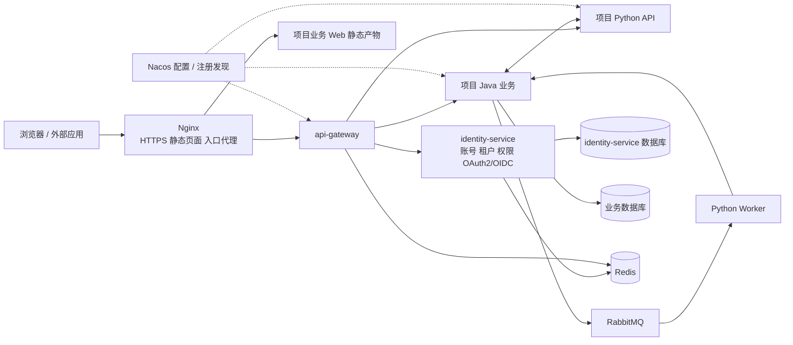

# 总体架构与工程结构设计

> 文档版本：1.8；文档集基线：D-20261027-05；更新：2026-10-27。  
> 状态：已确认的目标设计；不代表代码、脚本、镜像或运行能力已实现。  
> 本文负责：框架范围、模块、技术选型、工程目录、发行物和项目所有权。  
> 导航：[文档总入口](../01-文档导航.md)；本次开发基线见[实施计划](../plans/2026-10-27-编码规范与新项目开发基线-plan.md)；前轮流量保护任务与证据见[实施计划](../plans/2026-10-27-限流熔断与并发保护-plan.md)；历史混合接入见[原计划](../plans/2026-10-27-混合项目接入与审查修正-plan.md)。

本文定义目标合同，不记录逐任务进度。已有交付与本次变更的实际验证范围分别见对应实施计划，不能仅凭设计正文推断某个发行已验收。

| 章节 | 阅读目的 |
| --- | --- |
| [1. 目标、适用项目与范围](#scope) | 目标、适用项目与范围 |
| [2. 需求来源、设计决定与待确认边界](#decisions) | 需求来源、设计决定与待确认边界 |
| [3. 总体架构与运行链路](#topology) | 总体架构与运行链路 |
| [4. 技术选型与兼容基线](#technology) | 技术选型与兼容基线 |
| [5. 模块职责、复用方式与约束](#modules) | 模块职责、复用方式与约束 |
| [6. 框架仓库目录](#framework-layout) | 框架仓库目录 |
| [7. 新项目目录与文件所有权](#project-layout) | 新项目目录与文件所有权 |
| [8. 业务服务内部目录与职责](#service-layout) | 业务服务内部目录与职责 |
| [9. 框架发行物与依赖方式](#artifacts) | 框架发行物与依赖方式 |
| [10. 维护边界与基线升级](#ownership) | 维护边界与基线升级 |

<a id="scope"></a>

## 1. 目标、适用项目与范围

每个项目独立部署、独立数据库与租户。每个租户拥有独立账号；相同用户名跨租户不代表同一个账号。Java 承担平台与常规领域业务，Python 承担算法、AI Agent，也可独立承担领域服务。默认多机 Docker Compose，不引入 Kubernetes 或自研发布控制台。

框架运行服务只有 identity-service 和 api-gateway；公共包为 foundation、python-sdk。身份服务内置管理界面，不要求项目复制管理页、安装管理 npm 包或实现菜单权限。业务前端自行决定页面与按钮表现，后端始终做最终权限检查。

商城、支付、CRM、复杂部门/岗位数据授权、跨项目统一账号、可视化 Agent 编排平台不属于框架范围。当前数据范围固定 SELF/TENANT；没有对象的操作使用不适用范围。第三方组件的维护是交付的一部分，应用多副本不等于数据库或入口已高可用。

<a id="decisions"></a>

## 2. 已确认范围与边界

2026-10-27 用户确认精简计划与评审修正并授权实施，旧计划的全部阶段授权冻结。以下是最终职责，不承诺将移除的功能逐步补回。

| 事项 | 决定 |
| --- | --- |
| 项目与身份 | 独立项目部署、每租户独立账号、PG；identity-service 集成 Spring 成熟认证组件 |
| 通用基础 | identity-service、api-gateway；foundation、python-sdk；固定身份管理页面 |
| OAuth | 对外 OAuth2/OIDC、第三方登录、机器认证全部保留；不叠加第二套 IAM |
| 管理能力 | 平台管理员与受保护租户管理员；普通业务角色无管理权；无管理委派和授权模拟器 |
| 账号开户 | 管理员开户、首次改密与重置；公开自注册/邀请/邮件激活另案，不留占位接口 |
| 安全策略 | 项目统一策略；保持密码保护、会话隔离、撤权及审计，取消租户覆盖 |
| 业务边界 | Agent/聊天/算法任务、模型预算、检查点、工具账本均归具体业务项目，框架不实现 |
| 消息 | 可选 AMQP/JSON 与 Outbox/Inbox 事务适配；不影响纯 HTTP 接入 |
| 运维 | 多机 Compose、Ansible、Nginx、Flyway/Alembic；固定入口，不建发布控制台或通用编排引擎 |

历史 R-01 委派、R-03 模拟已退役；R-02 邀请/开放注册移出当前交付。历史事实保留在冻结计划与源码快照，不再作为活跃设计。真实提供方、服务器和容量输入缺失时对应验收保持未验证。

<a id="topology"></a>

## 3. 总体架构与运行链路



图中的 Worker 属于项目 Python 工程，和 API 可以使用同一镜像、不同启动命令。它不是框架新增的第三个基础服务。Python 需要持久化自己的业务数据时再配置独立数据库；纯计算 Worker 不强制接库。

| 单元 | 提供什么 | 不承担什么 |
| --- | --- | --- |
| Nginx 部署组件 | HTTPS、同源静态页面、转发到固定 Gateway 入口、连接与请求大小限制 | 不直接发现业务实例，不实现用户/租户/角色授权 |
| `foundation` | Java 自动配置与公共约定：身份、租户、权限、错误、HTTP、DB、MQ、日志 | 不放项目订单、文档、课程等业务对象；不成为独立进程 |
| `identity-service` | 租户账号、平台运维账号、角色权限、OAuth2 授权服务器、第三方登录、审计 | 不执行算法，不充当所有业务的数据库，不成为全局任务中心 |
| `api-gateway` | 统一入口、显式路由、浏览器 BFF、入口限流、转发和追踪 | 不替代业务服务最终鉴权，不直接操作业务表 |
| `python-sdk` | Python 统一接入包：配置发现、身份校验、租户上下文、HTTP、可选 DB/MQ 集成 | 不封装一套自有 ORM，不绑定某个 Agent 框架，不强制启动 Worker |
| 项目服务 | 领域数据、业务规则、业务权限落点、任务状态与算法 | 不复制用户密码库，不直接读写 identity-service 表 |

Redis、PostgreSQL、Nacos、RabbitMQ 是运行依赖，和“基础服务数量”分开计算。减少源码模块并不意味着可以省略这些组件的维护工作。

<a id="technology"></a>

## 4. 技术选型与兼容基线

| 能力 | 目标选型 | 原因及使用边界 |
| --- | --- | --- |
| Java | JDK 21、Maven Wrapper | 一致的语言与构建基线 |
| Java 框架 | Spring Boot 4.0.x、Spring Cloud 2025.1.x、Spring Cloud Alibaba 2025.1.x | 按官方匹配系列组合，不混搭 BOM |
| 认证与授权协议 | Spring Security 7.0 系列的 OAuth2 Authorization Server、OAuth2 Client、Resource Server | 同一技术体系处理第三方登录、对外 OAuth2/OIDC 和资源服务认证，集成在 identity-service |
| Java 流量治理 | Sentinel 1.8.9（SCA BOM） | 官方并发流控与熔断，Nacos 原生规则动态更新；不增加治理服务 |
| Gateway | Spring Cloud Gateway WebFlux | 与 Java 配置发现及 OAuth2 Client 集成；必须使用响应式适配 |
| Java 数据访问 | MyBatis-Plus，匹配 Boot 4 的 Starter；Flyway | 熟悉的 mapper 分层；迁移版本化 |
| Python | Python 3.12、uv、FastAPI、Pydantic 2、HTTPX | 标准工具管理包、类型验证和 HTTP |
| Python 数据访问 | SQLAlchemy 2 + psycopg 3、Alembic；按需启用 | 业务需要持久化时才引入 |
| 配置与发现 | Nacos 3.x；Java 使用 SCA；Python 使用官方 Nacos Python SDK 3.x | 两种语言使用同一服务目录和配置中心 |
| 数据库 | PostgreSQL 17，发布时选择该主版本受支持的补丁 | 每服务独立数据库与账号，可共用数据库实例；启用 RLS |
| Redis | Redis 7.2 兼容基线，锁定发行镜像与许可证 | 登录会话、BFF 会话、限流；业务缓存按需用；不承担可靠业务消息 |
| 消息 | RabbitMQ 4.x；Java Spring AMQP；Python aio-pika | 共享 AMQP 与 JSON 合同；不让 Java 模拟 Celery 私有任务协议 |
| 文件 | S3 API；标准服务端 SDK | 供应商由项目部署选择；跨主机文件使用对象存储，不传本机路径 |
| 观测 | 结构化日志、Micrometer / Prometheus 指标、OpenTelemetry 链路 | 默认输出标准信号，采集和展示可接现有运维平台 |
| 管理界面 | Vue 3 + TypeScript + Vue Router + Vite | identity-service/admin 为独立应用源码；构建后随身份镜像交付；examples/web 只含业务演示，不依赖管理页面实现 |
| 入口代理 | Nginx 官方镜像，实施计划的兼容冻结任务 锁定受支持版本及 digest | 生产默认入口；证书采用 Certbot 或已有企业证书，管理流程见 [应用部署与运维设计·部署拓扑、主机清单与发布输入](09-应用部署与运维设计.md#topology)；不新增业务微服务 |
| 部署 | Docker 镜像 + Compose v2 | 单机用于开发，多机通过私网可达地址连接 |
| 发布运维 | Ansible / community.docker + Compose | 运维触发统一部署入口；不开发发布控制台，不增加发布服务 |
| 数据库备份 | pgBackRest + 独立备份存储 | 基础备份、WAL 归档与恢复；采用成熟工具，发布前检查备份与恢复记录 |

**OAuth2 带来的选型修订：** 之前 Sa-Token 是集成认证的候选。用户要求完整的 OAuth2 三方向与 OIDC 后，本设计统一使用 Spring Security 授权服务器及客户端组件，不叠加第二套 Sa-Token 会话体系。它仍在 identity-service 内运行，符合已确认的部署结构。Spring Authorization Server 已进入 Spring Security 7 的发布体系；其协议组件可复用，但租户账号、授权策略、管理界面和数据存储集成仍由框架实现。[Spring 官方说明](https://spring.io/blog/2025/09/11/spring-authorization-server-moving-to-spring-security-7-0/)

上述版本是选定的兼容系列，不是已经通过联调的完整依赖锁。实施计划的兼容冻结任务 必须冻结确切补丁版本、镜像 digest 和许可证清单，验证 Gateway、授权服务器、ORM 和 Python Nacos SDK 后再发布。不能把“组件分别支持”写成“组合已经生产验证”。官方 SCA 对应表列出 Boot 4.0 / Cloud 2025.1 / SCA 2025.1 的匹配关系。[SCA 版本表](https://sca.aliyun.com/en/docs/2025.x/overview/version-explain/)

**复用成熟实现，自己只做统一接入：** 不重写 OAuth2 密码学、不重写 Nacos SDK、不重写 HTTP 客户端、不自建消息中间件。我们需要维护的内容是租户/权限业务模型、框架配置、公共上下文、统一错误与少量适配，以及能真正使用它们的项目示例。

<a id="modules"></a>

## 5. 模块职责、复用方式与约束

| 参考点 | 我们的采用方式 |
| --- | --- |
| 芋道 system 模块集中提供用户、租户、角色和权限 | 保留，不按这些实体拆服务 |
| Java controller / service / dal 分层 | 保留，以业务子包组织 |
| 公共框架与业务代码分离 | 保留，通过版本依赖复用 |
| 多个业务模块和大量技术 Starter | 本设计压缩为一个 Java 公共模块，内部按包和条件自动配置组织 |
| 租户上下文及数据库过滤 | 增加 PostgreSQL RLS 与跨语言测试；不能只靠入口 header 或某个 ORM 插件 |
| 部署示例和代码生成 | 采用可运行项目示例；多机网络、迁移和服务鉴权自行补齐 |

不把上游演示配置直接视为生产配置，不默认信任 `login-user` 等明文身份头，不把“加了 tenant_id”当成所有数据已隔离，也不把 RabbitMQ 发布成功当成业务已完成。借用上游源码时记录固定提交及许可证归属，保留必要声明；本设计并不要求整体 Fork。

参考入口：[芋道 Cloud 仓库](https://github.com/YunaiV/yudao-cloud)。该项目在本设计中是组织方式参考，本文所有接口、表名和目录均为我们的拟定合同，不宣称是上游原样实现。

独立项目部署、租户独立账号、两个基础服务、身份服务内集成完整 OAuth2/OIDC、PostgreSQL 隔离、顶层 examples、按服务拥有数据库和迁移均保持。Keycloak/Casdoor 只用于讨论产品模型，当前不集成或部署它们。

局部类名、索引名称、格式化细节可以在实施中确定；精确依赖补丁与镜像 digest 必须通过兼容验证冻结。兼容验证失败时反馈具体证据并修订设计，不擅自更换整套技术栈或放宽安全行为。

<a id="framework-layout"></a>

## 6. 框架仓库目录

以下为目标结构；已有协作规则文件仍保留，不因示意图未列出而删除。

命名统一规则：目录、镜像与注册服务名使用小写连字符；Java 包使用小写点分层，Python import 包使用下划线。框架目录反映职责，业务服务按领域命名；不以 `business`、`system`、`common` 作为我们新服务的兜底名称。当前没有已发布制品或存量接口，本设计直接更新计划中的目标名称，不增加旧名别名或兼容层。

**代码根与路径约定：** 框架仓库根只保留协作规则文件、`docs/` 与 `framework/`；全部代码、示例与部署材料位于 `framework/`。本文及各设计、指南、规范与实施计划中的相对路径（如 `config/`、`infra/`、`deploy/`、`examples/`、`identity-service/`）在框架仓库内相对 `framework/`，在新项目内相对项目根；除明确指向仓库物理结构外，不逐处标注 `framework/` 前缀。打包器将 examples/services 与 examples/web 分别放到发行项目根的 services 与 web；其他运行材料保留 config/infra/deploy/examples 路径。项目无需手工拼接两套示例。

| 用途 | 目录 / 服务名 | 发布与代码名称 |
| --- | --- | --- |
| Java 公共基础 | `foundation` | Maven `com.ken.platform:foundation`；包 `com.ken.platform.foundation` |
| 身份与租户权限服务 | `identity-service` | 同名镜像/Nacos 名；包 `com.ken.platform.identity`；启动类 `IdentityApplication` |
| API 入口 | `api-gateway` | 同名镜像/Compose 名；包 `com.ken.platform.gateway` |
| Python 接入 SDK | `python-sdk` | 分发包 `ken-platform-sdk`；import 包 `ken_platform_sdk` |
| 身份管理界面 | `identity-service/admin` | 固定 `/identity/admin/` 入口；静态产物内置身份镜像，无额外运行服务 |
| Java 版本与构建约束 | 根 POM | Maven `com.ken.platform:platform-parent`；不增加目录或进程 |
| 文档示例 | 项目 `doc-insight`，服务 `document-service` / `analysis-service` | Java 管领域数据，Python 管分析；Python 包 `document_analysis` |

注册名按服务职责命名，namespace 隔离项目/环境；副本 ID 表示实例，不能把每个节点注册成不同业务服务。框架仓库名保持 `micro-service`；设计与实施文件分别维护。

```text
micro-service/
├── AGENTS.md / CLAUDE.md / README.md
├── docs/                         # design / guides / standards / plans
└── framework/
    ├── pom.xml / mvnw / mvnw.cmd  # 三个核心 Java 模块；示例独立构建
    ├── pyproject.toml / uv.lock   # 运维工具环境
    ├── foundation/               # config/security/web/http/data/discovery/messaging
    ├── identity-service/         # 用户、租户、角色、应用、协议及审计
    │   ├── admin/                # Vue 管理应用，产物内置同一身份镜像
    │   └── src/main/             # Java 与 resources/db/migration
    ├── api-gateway/              # 路由、BFF、入口鉴权；不放业务 DAL
    ├── python-sdk/               # config/security/context/discovery/http/db/messaging
    ├── examples/                 # 一个 Java + Python 混合项目
    │   ├── services/
    │   │   ├── sample-java-service/   # 独立 POM、迁移、权限清单、Dockerfile
    │   │   └── sample-python-service/ # 独立 pyproject、锁定依赖、迁移、Dockerfile
    │   ├── web/                  # 两服务共用的普通业务演示页
    │   ├── config/               # 示例业务配置与绑定说明
    │   ├── compose.yaml          # 同一应用栈的两个业务服务
    │   ├── verification/         # 示例链验证工具，不进入业务镜像
    │   └── README.md / prepare_local.py / .gitignore
    ├── config/                   # 环境样例、Nacos 源、开发登记、配置发布
    ├── infra/                    # 组件 Compose、资源声明与初始化
    └── deploy/                   # 应用 Compose、Nginx、迁移和 Ansible 入口
```

规范约束：

1. Maven 子模块是构建和发布边界；Java 包是代码组织边界。新增一个包不等于新增服务。
2. 一个可部署业务服务默认一个 Maven 模块。没有独立消费者与版本管理需求，不拆 `api` / `biz` / `server`。
3. `foundation` 的技术依赖采用 optional / 条件装配。Gateway 引入它不能被动带入 JDBC、MyBatis 或 Servlet；必须专门验证 WebFlux 场景。
4. 数据访问、MQ 等能力只在项目显式引入依赖并启用后装配。不要为了“通用”给纯 HTTP Python 服务装完整模型库和数据库依赖。
5. `client`、`mq`、`job` 等目录按需创建，不在每个服务中强制堆空目录。禁止建立无边界的 `utils`、`manager`、`core` 杂物目录。
6. Java 测试放各模块 `src/test`，Python 测试放各工程 `tests`；接口合同跟随所属服务。本设计不新增顶层 contracts 仓库或独立权限仓库。
7. examples 内各服务与 Web 独立构建，从候选/正式制品仓库解析依赖；不加入根 POM 的三个核心模块聚合。身份管理静态资源由 identity-service 构建与打包，项目不复制或重新构建管理页面。deploy 放部署配置与执行入口，不放业务演示源码。

<a id="project-layout"></a>

## 7. 新项目目录与文件所有权

以下是发行包展开后的混合项目，framework 源码不进入业务仓库。默认同时包含两语言服务；日后确实不需要某个服务时，连同其路由/资源/凭据声明明确移除。

```text
asset-project/
├── services/
│   ├── sample-java-service/   # Java 普通资源服务，可改为领域名
│   └── sample-python-service/ # Python 普通资源服务，与 Java 双向调用
├── web/                     # 可选业务前端；身份后台不复制
├── config/                  # 环境绑定、Nacos 源和发布工具
├── infra/                   # 自建依赖定义、初始化与资源输入
├── deploy/                  # 应用 Compose、Nginx、迁移与发布入口
├── pyproject.toml           # 运维工具环境，与业务环境分开
├── uv.lock
├── framework-baseline.json # 原发行版本与材料摘要
├── README.md / AGENTS.md / CLAUDE.md / .cursor/rules/project.mdc
├── .editorconfig / .gitattributes
└── docs/                    # standards/01—03 与 guides/04 随发行交付
```

项目团队维护复制后的源码/环境/运行材料；框架维护者交付新基线及差异。升级按原基线、新基线、项目改动三方比较，不整目录覆盖。工具依赖和业务依赖分别锁定；Windows 本地开发、Linux/WSL Ansible 控制机的操作分别说明。

开发材料随同一发行交付：三份通用/Java/Python 规范、开发升级指南、简短协作入口、编辑器配置及两个服务的测试。规范取仓库 docs 的唯一源，协作入口取 examples；不复制历史计划或框架内部测试，项目补充规范由项目自行维护。材料均纳入原 manifest/framework-baseline.json 哈希，升级仍按三方比较。

完整发行包含 Maven parent POM/foundation JAR、Python wheel、身份与网关镜像、examples、config/infra/deploy 及根工具环境、校验和、许可证与兼容说明。可本地构建候选制品验证，但最终团队必须能获取同一固定版本；不能引用框架源码相对路径或依赖开发者已有缓存。

<a id="service-layout"></a>

## 8. 业务服务内部目录与职责

每个 Java 业务服务使用 src/main/java/项目包 下的 controller/dto、service、dal、client；JDBC 的具体 Repository 可直接放 dal，简单只读业务投影可放 model（不代表强制 ORM），只有使用相应 ORM/MyBatis 时才增加 dataobject/mapper，有消息需求时才增加 mq；迁移放 src/main/resources/db/migration，权限清单放 src/main/resources/permissions.yaml。启动类与领域包位于服务自身工程，不新增 api/biz/server 三套部署模块。

Python 每服务在 src/业务包 下按需要设置 api、schemas、services、repositories、clients；main.py 负责应用装配，config.py 保存业务设置。仅实际使用 ORM 时增加 models；agents/tasks 属于有此需求的业务项目，不是框架默认结构；迁移放工程根 migrations，权限清单放 src/业务包/resources/permissions.yaml 并声明为包资源。模型供应商适配放 clients，Agent/算法编排放 agents/services。只建立真实用到的目录，不要求纯 HTTP 服务有 ORM/Worker。

编排层处理用例，DAL/Repository 处理持久化，Client 处理外部调用。规范文档约束依赖方向与命名，示例及指南引用本节路径；变更位置先更新本节，再同步包资源构建、发行清单和指南。

<a id="artifacts"></a>

## 9. 框架发行物与依赖方式

框架维护者发布一次，项目团队按版本使用。本设计使用标准包仓库、镜像仓库和版本标签下的 examples，不开发自有 `framework init` CLI，也不维护第二套脚手架源码。

| 发行物 | 使用者 | 使用方式 |
| --- | --- | --- |
| Maven `com.ken.platform:platform-parent` | Java 项目 | 继承版本管理、构建插件和统一依赖约束 |
| Maven `com.ken.platform:foundation` | Java 服务 | 引入公共接入能力；按服务用途添加官方依赖 |
| Python `ken-platform-sdk`（import 名 `ken_platform_sdk`） | Python 服务 | 基础包 + 可选 `db` / `mq`；精确固定版本；不提供 Agent 运行时 |
| `identity-service` 镜像 | 每个项目 | 内置用户/角色/权限等完整管理界面，使用本项目配置、数据库和密钥运行 |
| `api-gateway` 镜像 | 每个项目 | 使用自己的路由、issuer、BFF 客户端配置运行 |
| Nginx 入口部署材料 | 每个项目运维 | 锁定官方镜像 digest；复用 deploy/nginx 与应用 Compose 中的 nginx 服务，填域名/上游/证书及可选业务静态目录 |
| 发行标签下的 `examples` | 新项目团队 | 单一混合项目，两服务打包到根 services；在同一项目内改为自己的业务 |
| 同标签的 `config` | 项目开发/运维 | 环境绑定样例、Nacos 参数源和固定发布工具 |
| 同标签的 `infra` | 项目运维 | 组件运行定义、资源初始化及备份维护材料 |
| 同标签的 `deploy` | 项目运维 | 应用 Compose、Nginx、迁移调用和 Ansible 流程；不存组件参数或业务 SQL |
| 发行说明与校验值 | 开发与运维 | 说明兼容矩阵、迁移、已知限制、镜像 digest、源码版本与许可证 |

版本示例统一使用 `1.0.0`，仅表示目标发行版本，不代表当前已经发布。框架维护者的交付验收必须从候选制品仓库安装示例依赖，不能只通过本地源码联编来证明项目可接入。

框架升级按兼容清单改变项目的 Maven/Python 依赖、服务镜像及必要配置，不通过覆盖整个项目目录更新业务代码。管理页面随 identity-service 镜像升级；身份 API 兼容时无须重建业务 Web。examples 中的业务入口与演示只提供起点，其变更按明确 diff/升级说明吸收。发布页可附同标签源码与运行材料归档，但不能生成另一份独立维护的模板。

<a id="ownership"></a>

## 10. 维护边界与基线升级

框架维护者拥有公共包、基础镜像和示例基线；项目团队拥有复制后的领域代码、实际环境配置和数据。镜像升级不覆盖项目文件，复制目录升级也不能覆盖整个项目。

| 对象 | 谁发新版 | 项目接入动作 | 需要检查 |
| --- | --- | --- | --- |
| foundation/python-sdk | 框架维护者 | 修改依赖/锁文件，重建受影响服务 | API、可选消息适配与业务兼容 |
| identity/gateway | 框架维护者 | 更新固定 digest，按迁移合同升级 | 登录/权限/路由及旧客户端 |
| examples | 框架维护者 | 初次复制；之后按差异自行采纳 | 业务改动不能被示例覆盖 |
| config/infra/deploy | 框架维护者提供基线，项目维护实例 | 比较原基线/新基线/项目版本后合并 | 地址、秘密、卷、资源归属保持 |
| 业务迁移/权限清单 | 业务服务维护者 | 随业务制品发布和受控同步 | 不自动扩权，不倒退数据库 |

每个复制项目保存 framework-baseline（发行标签及归档摘要），release-manifest 记录实际依赖、镜像、配置和迁移版本；不以“我用的是最新版”作为升级输入。变更可兼容才滚动发布，不能兼容则在设计中明确维护窗口及迁移步骤。

工程目录是职责和交付边界，不是新增运行进程的理由。没有独立部署需求不把用户、角色、权限各拆成服务，也不为 SDK 内部技术包拆出服务。

参考资料：以下为组件参考资料；本次只重新核验了认证文档新增引用的 Spring 客户端模型与 NIST 密码建议，其余在线版本未重新核验。框架具体默认策略由本文定义，不能认为引用组件就自动实现了全部业务合同；实施兼容冻结任务须复核版本与能力。

| 来源 | 参考用途 |
| --- | --- |
| [芋道 Cloud](https://github.com/YunaiV/yudao-cloud) | Java 公共能力与 system 模块组织的参考 |
| [SCA 版本关系](https://sca.aliyun.com/en/docs/2025.x/overview/version-explain/) | Boot / Cloud / SCA 必须按匹配系列管理 |
| [MyBatis-Plus 安装](https://baomidou.com/en/getting-started/install/) | 使用对应 Spring Boot 版本的 Starter |

- 2026-10-27，D-20261027-03：统一混合项目目录及接入路径；业务配置扩展、管理页和发布恢复合同按计划 05 修正；实际验收见计划 05。

- 2026-10-27，D-20261027-04：按已确认 Sentinel 计划同步原生网关、Java 动态规则、Python 并发和调用边界；目标合同不代表已完成运行验收。

- 2026-10-27，D-20261027-05：用户确认编码规范与新项目开发基线计划；明确按需服务目录、JDBC Repository 合法位置，以及规范/检查/业务测试随发行交付；运行协议保持。
