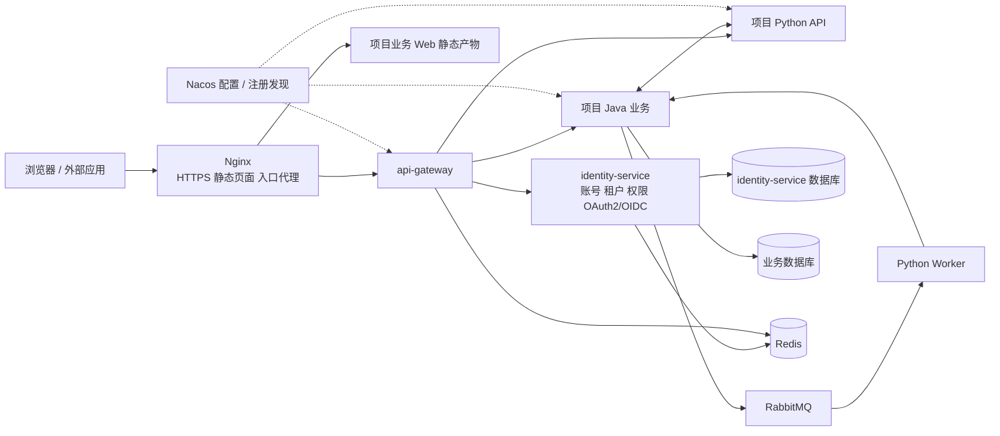

# 总体架构与工程结构设计

> 文档版本：1.1；文档集基线：D-20261026-03；更新：2026-10-26。  
> 状态：目标设计，待整体评审；不代表代码、脚本、镜像或运行能力已实现。  
> 本文负责：框架范围、模块、技术选型、工程目录、发行物和项目所有权。  
> 导航：[文档总入口](../01-文档导航.md)；任务与证据见[实施计划](../plans/01-微服务框架实施计划.md)。

文中的路径、接口、配置和命令均为拟交付合同；当前仓库只有文档，不能直接执行这些命令启动系统。

| 章节 | 阅读目的 |
| --- | --- |
| [1. 目标、适用项目与范围](#scope) | 目标、适用项目与范围 |
| [2. 需求来源、设计决定与待确认边界](#decisions) | 需求来源、设计决定与待确认边界 |
| [3. 总体架构与运行链路](#topology) | 总体架构与运行链路 |
| [4. 技术选型与兼容基线](#technology) | 技术选型与兼容基线 |
| [5. 模块职责、复用方式与约束](#modules) | 模块职责、复用方式与约束 |
| [6. 框架仓库目录](#framework-layout) | 框架仓库目录 |
| [7. 新项目目录与文件所有权](#project-layout) | 新项目目录与文件所有权 |
| [8. 业务服务内部目录与职责](#service-layout) | 业务服务内部目录与职责 |
| [9. 框架发行物与依赖方式](#artifacts) | 框架发行物与依赖方式 |
| [10. 维护边界与基线升级](#ownership) | 维护边界与基线升级 |

<a id="scope"></a>

## 1. 目标、适用项目与范围

每个项目独立部署、独立数据库与租户。每个租户拥有独立账号；相同用户名跨租户不代表同一个账号。Java 承担平台与常规领域业务，Python 承担算法、AI Agent，也可独立承担领域服务。默认多机 Docker Compose，不引入 Kubernetes 或自研发布控制台。

框架运行服务只有 identity-service 和 api-gateway；公共包为 foundation、python-sdk。身份服务内置管理界面，不要求项目复制管理页、安装管理 npm 包或实现菜单权限。业务前端自行决定页面与按钮表现，后端始终做最终权限检查。

商城、支付、CRM、复杂部门/岗位数据授权、跨项目统一账号、可视化 Agent 编排平台不属于框架范围。当前数据范围固定 SELF/TENANT；没有对象的操作使用不适用范围。第三方组件的维护是交付的一部分，应用多副本不等于数据库或入口已高可用。

<a id="decisions"></a>

## 2. 需求来源、设计决定与待确认边界

本节区分用户明确要求的能力与框架作者提出的实现方案。“要求讨论/比较”不等于批准每个具体产品功能；旧文档已经写入也不等于用户逐项确认。本次授权是修订文档，不能追认历史确认，更不能替代实施授权。

| 编号 | 能力与来源 | 当前边界 / 状态 | 实施影响 |
| --- | --- | --- | --- |
| S-01 | 用户明确选择多机 Docker Compose、独立项目部署、每租户独立账号、PG、认证内置身份服务 | 已明确的目标需求 | 所有任务必须保持 |
| S-02 | 用户要求 OAuth2 全方向及 OIDC、通用用户角色权限管理页、不要菜单权限/管理 npm 包 | 已明确的目标需求 | 协议、账号/角色、资源操作配置及有效权限查询纳入目标 |
| S-03 | 用户明确要求聊天 Agent 多节点、迁移升级、Nginx、开发/部署环境和新项目接入 | 已明确的目标需求 | 运行状态、数据恢复、固定部署入口不可省略；不增加发布控制台 |
| D-01 | 上述部署需求必须支持新环境与新增服务 | 固定资源声明、create/verify、幂等检查是实现手段；不做通用工作流/插件/任意 SQL 编排 | T-02 按固定 PG/Redis/Nacos/Rabbit 适配实现 |
| D-02 | OAuth2 组件、权限扩展表、安全默认值、状态机及目录组织 | 框架设计选择，本文档集明确可执行合同；须随实施方案审阅，不能标为用户逐字段指定 | 相应任务实施前检查版本与合同 |
| R-01 | 普通管理员按明确角色委派、可编辑权限上限及并发控制 | **待单独确认**；当前章节为候选完整设计。基础目标先支持受保护租户管理员管理本租户，普通业务角色不自动获得管理权 | T-03B/T-07B 的委派扩展不得静默实施；相关验收保持待确认 |
| R-02 | 邀请/开放注册、邀请令牌、邮件验证及相应激活流程 | 用户讨论过注册能力，但未单独确认三模式全量产品范围；**INVITE/OPEN 待单独确认**，ADMIN_ONLY 为默认基线 | 不删候选设计；T-04B 的扩展分支及其页面、发送链路须确认后实施 |
| R-03 | 独立的授权模拟 API 和完整预览交互 | 有效权限与角色来源查询属于通用管理；独立模拟产品功能 **待单独确认** | T-03A 保留统一内部计算器；T-03B/T-07B 的模拟 API/页面 在确认后实施 |
| D-03 | 用户激活后的业务资料初始化 | 身份服务提供生命周期事实；业务有资料需求时才消费，不为每个项目强制建立档案 | 消费幂等是可靠消息的一部分；注册扩展事件受 R-02 约束 |
| D-04 | HTTPS 证书配置 | Nginx/TLS 属明确部署需求；支持 provided/ACME 两种固定维护路径是实现方案，不自建证书平台 | T-13A 验证实际选用路径及另一模式的配置边界 |

R 项保留完整候选合同，是为了便于决定，不代表删掉最终需求或默认批准。确认时记录“纳入/修改/不纳入”、范围和日期；不纳入时同步修改对应正文、AC、任务和指南，不能直接将既有 AC 标记不适用。未确认项只阻塞受影响子任务，不阻塞基础接入与无关实现。

本次 D-20261026-03 是对评审问题的修订，不声称旧版所有新增内容都在拆分时出现，也不伪造无法追溯的逐项确认记录。

<a id="topology"></a>

## 3. 总体架构与运行链路



图中的 Worker 属于项目 Python 工程，和 API 可以使用同一镜像、不同启动命令。它不是框架新增的第三个基础服务。Python 需要持久化自己的业务数据时再配置独立数据库；纯计算 Worker 不强制接库。

| 单元 | 提供什么 | 不承担什么 |
| --- | --- | --- |
| Nginx 部署组件 | HTTPS、同源静态页面、转发到固定 Gateway 入口、连接与请求大小限制 | 不直接发现业务实例，不实现用户/租户/角色授权 |
| `foundation` | Java 自动配置与公共约定：身份、租户、权限、错误、HTTP、DB、MQ、日志 | 不放项目订单、文档、课程等业务对象；不成为独立进程 |
| `identity-service` | 租户账号、平台运维账号、角色权限、OAuth2 授权服务器、第三方登录、审计 | 不执行算法，不充当所有业务的数据库，不成为全局任务中心 |
| `api-gateway` | 统一入口、显式路由、浏览器 BFF、入口限流、转发和追踪 | 不替代业务服务最终鉴权，不直接操作业务表 |
| `python-sdk` | Python 统一接入包：配置发现、身份校验、租户上下文、HTTP、可选 DB/MQ 集成 | 不封装一套自有 ORM，不绑定某个 Agent 框架，不强制启动 Worker |
| 项目服务 | 领域数据、业务规则、业务权限落点、任务状态与算法 | 不复制用户密码库，不直接读写 identity-service 表 |

Redis、PostgreSQL、Nacos、RabbitMQ 是运行依赖，和“基础服务数量”分开计算。减少源码模块并不意味着可以省略这些组件的维护工作。

<a id="technology"></a>

## 4. 技术选型与兼容基线

| 能力 | 目标选型 | 原因及使用边界 |
| --- | --- | --- |
| Java | JDK 21、Maven Wrapper | 一致的语言与构建基线 |
| Java 框架 | Spring Boot 4.0.x、Spring Cloud 2025.1.x、Spring Cloud Alibaba 2025.1.x | 按官方匹配系列组合，不混搭 BOM |
| 认证与授权协议 | Spring Security 7.0 系列的 OAuth2 Authorization Server、OAuth2 Client、Resource Server | 同一技术体系处理第三方登录、对外 OAuth2/OIDC 和资源服务认证，集成在 identity-service |
| Gateway | Spring Cloud Gateway WebFlux | 与 Java 配置发现及 OAuth2 Client 集成；必须使用响应式适配 |
| Java 数据访问 | MyBatis-Plus，匹配 Boot 4 的 Starter；Flyway | 熟悉的 mapper 分层；迁移版本化 |
| Python | Python 3.12、uv、FastAPI、Pydantic 2、HTTPX | 标准工具管理包、类型验证和 HTTP |
| Python 数据访问 | SQLAlchemy 2 + psycopg 3、Alembic；按需启用 | 业务需要持久化时才引入 |
| 配置与发现 | Nacos 3.x；Java 使用 SCA；Python 使用官方 Nacos Python SDK 3.x | 两种语言使用同一服务目录和配置中心 |
| 数据库 | PostgreSQL 17，发布时选择该主版本受支持的补丁 | 每服务独立数据库与账号，可共用数据库实例；启用 RLS |
| Redis | Redis 7.2 兼容基线，锁定发行镜像与许可证 | 登录会话、BFF 会话、限流；业务缓存按需用；不承担可靠业务消息 |
| 消息 | RabbitMQ 4.x；Java Spring AMQP；Python aio-pika | 共享 AMQP 与 JSON 合同；不让 Java 模拟 Celery 私有任务协议 |
| 文件 | S3 API；标准服务端 SDK | 供应商由项目部署选择；跨主机文件使用对象存储，不传本机路径 |
| 观测 | 结构化日志、Micrometer / Prometheus 指标、OpenTelemetry 链路 | 默认输出标准信号，采集和展示可接现有运维平台 |
| 管理界面 | Vue 3 + TypeScript + Vue Router + Vite | identity-service/admin 为独立应用源码；构建后随身份镜像交付；examples/web 只含业务演示，不依赖管理页面实现 |
| 入口代理 | Nginx 官方镜像，实施计划的兼容冻结任务 锁定受支持版本及 digest | 生产默认入口；证书采用 Certbot 或已有企业证书，管理流程见 [应用部署与运维设计·部署拓扑、主机清单与发布输入](09-应用部署与运维设计.md#topology)；不新增业务微服务 |
| 部署 | Docker 镜像 + Compose v2 | 单机用于开发，多机通过私网可达地址连接 |
| 发布运维 | Ansible / community.docker + Compose | 运维触发统一部署入口；不开发发布控制台，不增加发布服务 |
| 数据库备份 | pgBackRest + 独立备份存储 | 基础备份、WAL 归档与恢复；采用成熟工具，发布前检查备份与恢复记录 |

**OAuth2 带来的选型修订：** 之前 Sa-Token 是集成认证的候选。用户要求完整的 OAuth2 三方向与 OIDC 后，本设计统一使用 Spring Security 授权服务器及客户端组件，不叠加第二套 Sa-Token 会话体系。它仍在 identity-service 内运行，符合已确认的部署结构。Spring Authorization Server 已进入 Spring Security 7 的发布体系；其协议组件可复用，但租户账号、授权策略、管理界面和数据存储集成仍由框架实现。[Spring 官方说明](https://spring.io/blog/2025/09/11/spring-authorization-server-moving-to-spring-security-7-0/)

上述版本是选定的兼容系列，不是已经通过联调的完整依赖锁。实施计划的兼容冻结任务 必须冻结确切补丁版本、镜像 digest 和许可证清单，验证 Gateway、授权服务器、ORM 和 Python Nacos SDK 后再发布。不能把“组件分别支持”写成“组合已经生产验证”。官方 SCA 对应表列出 Boot 4.0 / Cloud 2025.1 / SCA 2025.1 的匹配关系。[SCA 版本表](https://sca.aliyun.com/en/docs/2025.x/overview/version-explain/)

**复用成熟实现，自己只做统一接入：** 不重写 OAuth2 密码学、不重写 Nacos SDK、不重写 HTTP 客户端、不自建消息中间件。我们需要维护的内容是租户/权限业务模型、框架配置、公共上下文、统一错误与少量适配，以及能真正使用它们的项目示例。

<a id="modules"></a>

## 5. 模块职责、复用方式与约束

| 参考点 | 我们的采用方式 |
| --- | --- |
| 芋道 system 模块集中提供用户、租户、角色和权限 | 保留，不按这些实体拆服务 |
| Java controller / service / dal 分层 | 保留，以业务子包组织 |
| 公共框架与业务代码分离 | 保留，通过版本依赖复用 |
| 多个业务模块和大量技术 Starter | 本设计压缩为一个 Java 公共模块，内部按包和条件自动配置组织 |
| 租户上下文及数据库过滤 | 增加 PostgreSQL RLS 与跨语言测试；不能只靠入口 header 或某个 ORM 插件 |
| 部署示例和代码生成 | 采用可运行项目示例；多机网络、迁移和服务鉴权自行补齐 |

不把上游演示配置直接视为生产配置，不默认信任 `login-user` 等明文身份头，不把“加了 tenant_id”当成所有数据已隔离，也不把 RabbitMQ 发布成功当成业务已完成。借用上游源码时记录固定提交及许可证归属，保留必要声明；本设计并不要求整体 Fork。

参考入口：[芋道 Cloud 仓库](https://github.com/YunaiV/yudao-cloud)。该项目在本设计中是组织方式参考，本文所有接口、表名和目录均为我们的拟定合同，不宣称是上游原样实现。

独立项目部署、租户独立账号、两个基础服务、身份服务内集成完整 OAuth2/OIDC、PostgreSQL 隔离、顶层 examples、按服务拥有数据库和迁移均保持。Keycloak/Casdoor 只用于讨论产品模型，当前不集成或部署它们。

局部类名、索引名称、格式化细节可以在实施中确定；精确依赖补丁与镜像 digest 必须通过兼容验证冻结。兼容验证失败时反馈具体证据并修订设计，不擅自更换整套技术栈或放宽安全行为。

<a id="framework-layout"></a>

## 6. 框架仓库目录

以下为目标结构；已有协作规则文件仍保留，不因示意图未列出而删除。

命名统一规则：目录、镜像与注册服务名使用小写连字符；Java 包使用小写点分层，Python import 包使用下划线。框架目录反映职责，业务服务按领域命名；不以 `business`、`system`、`common` 作为我们新服务的兜底名称。当前没有已发布制品或存量接口，本设计直接更新计划中的目标名称，不增加旧名别名或兼容层。

| 用途 | 目录 / 服务名 | 发布与代码名称 |
| --- | --- | --- |
| Java 公共基础 | `foundation` | Maven `com.ken.platform:foundation`；包 `com.ken.platform.foundation` |
| 身份与租户权限服务 | `identity-service` | 同名镜像/Nacos 名；包 `com.ken.platform.identity`；启动类 `IdentityApplication` |
| API 入口 | `api-gateway` | 同名镜像/Compose 名；包 `com.ken.platform.gateway` |
| Python 接入 SDK | `python-sdk` | 分发包 `ken-platform-sdk`；import 包 `ken_platform_sdk` |
| 身份管理界面 | `identity-service/admin` | 固定 `/identity/admin/` 入口；静态产物内置身份镜像，无额外运行服务 |
| Java 版本与构建约束 | 根 POM | Maven `com.ken.platform:platform-parent`；不增加目录或进程 |
| 文档示例 | 项目 `doc-insight`，服务 `document-service` / `analysis-service` | Java 管领域数据，Python 管分析；Python 包 `document_analysis` |
| 聊天示例 | 项目 `chat-assistant`，服务 `agent-service` | Python 包 `chat_agent`；同镜像 `api` / `worker` 启动角色 |

注册名按服务职责命名，namespace 隔离项目/环境；副本 ID 表示实例，不能把每个节点注册成不同业务服务。框架仓库名保持 `micro-service`；设计与实施文件分别维护。

```text
micro-service/
├── pom.xml                         # platform-parent，同时聚合三个 Java 模块
├── pyproject.toml / uv.lock         # 仅配置/初始化/发布工具依赖；不含业务运行依赖
├── mvnw / mvnw.cmd / .mvn/          # 固定 Maven 版本
├── foundation/               # 一个 Java 发布包，内部按技术职责分包
│   ├── pom.xml
│   └── src/main/java/com/ken/platform/foundation/
│       ├── config/                 # 自动配置和配置属性
│       ├── security/               # 身份、权限、内省适配
│       ├── tenant/                 # 租户上下文与边界检查
│       ├── web/                    # 错误响应，mvc / reactive 子包
│       ├── http/                   # 服务发现与客户端工厂
│       ├── data/                   # PG / MyBatis 适配、事务租户设置
│       ├── messaging/              # 事件 envelope、Outbox/Inbox 支持
│       └── observability/          # 日志字段、指标、追踪
├── identity-service/
│   ├── pom.xml
│   ├── Dockerfile                 # 构建管理静态资源并打入同一 Java 镜像
│   ├── admin/                     # Vue 独立管理应用；详细目录见 《身份管理界面设计·管理对象、入口与使用者》
│   │   ├── src/                   # app、pages、api、components
│   │   ├── tests/
│   │   └── package.json / pnpm-lock.yaml
│   └── src/main/
│       ├── java/com/ken/platform/identity/
│       │   ├── IdentityApplication.java
│       │   ├── controller/         # auth、tenant、user、role、oauth、audit 子包
│       │   ├── service/            # 相同业务子包；不强制 interface + impl
│       │   ├── dal/dataobject/
│       │   ├── dal/mapper/
│       │   ├── config/             # 安全过滤链、授权服务器配置
│       │   ├── client/             # 需要远程调用时才创建
│       │   ├── mq/                 # 需要事件处理时才创建
│       │   └── job/                # 凭证清理、Outbox 投递等本服务任务
│       └── resources/
│           ├── application.yml
│           ├── db/migration/
│           └── templates/          # 登录、首次改密、重置与授权同意页
├── api-gateway/
│   ├── pom.xml
│   └── src/main/                   # config、filter、security；无业务 DAL
├── python-sdk/
│   ├── pyproject.toml
│   ├── uv.lock
│   ├── src/ken_platform_sdk/
│   │   ├── config.py
│   │   ├── security.py
│   │   ├── tenant.py
│   │   ├── discovery.py
│   │   ├── http.py
│   │   ├── errors.py
│   │   ├── db/                     # 可选依赖
│   │   ├── messaging/              # 可选依赖
│   │   ├── runtime/                # 可选：Run、租约、检查点、工具记录；库内目录
│   │   ├── streaming/              # 可选：SSE 事件、游标回放、连接控制；库内目录
│   │   ├── integrations/langgraph/ # 可选的受控检查点适配，不强绑基础包
│   │   └── observability.py
│   └── tests/
├── examples/                       # 可运行源码；也是新项目的唯一复制起点
│   ├── README.md                   # Java / Python / 聊天示例选择与接入步骤
│   ├── java/document-service/      # 独立 POM、Maven Wrapper、迁移、测试和 Dockerfile
│   ├── python/analysis-service/    # 算法 API / Worker；独立 pyproject 与 uv.lock
│   ├── python/agent-service/       # 可选聊天 API / Worker；同镜像双角色
│   └── web/                        # 可选业务 Web 起点，只有文档/聊天演示与身份 API 接入
├── config/                         # 应用环境绑定与 Nacos 配置源
│   ├── environments/               # local/test/prod；只有示例和非敏感配置
│   ├── nacos/                      # 公共参数及每服务的运行参数
│   └── publish.py                  # 固定配置发布入口，不运行任意远程命令
├── infra/                          # 第三方依赖的独立生命周期
│   ├── compose.yaml                # PG、Redis、Nacos；Rabbit 按组合启用
│   ├── resources.yaml              # 项目所需数据库、角色、namespace 与 vhost
│   ├── postgres/                   # 实例参数、备份恢复配置
│   ├── redis/
│   ├── nacos/                      # Nacos 自己的服务端配置
│   ├── rabbitmq/
│   └── init/                       # 建库/账号、namespace、vhost 的幂等初始化
├── deploy/                         # 应用镜像的运行与发布
│   ├── compose.yaml                # identity、gateway、所选业务及入口
│   ├── nginx/                      # HTTP/HTTPS、静态页面与流式代理
│   ├── release.yaml                # 镜像、迁移入口、目标主机与兼容声明
│   ├── ansible/                    # 分开调用依赖、初始化、迁移、应用发布
│   └── scripts/                    # 固定的开发启动/迁移协调入口
├── docs/
│   ├── design/                     # 按主题拆分的中文权威设计
│   ├── guides/                     # 新项目接入与开发操作指南
│   ├── standards/                  # 项目编码规范
│   └── plans/                      # 日期命名的实施计划与执行记录
└── README.md
```

规范约束：

1. Maven 子模块是构建和发布边界；Java 包是代码组织边界。新增一个包不等于新增服务。
2. 一个可部署业务服务默认一个 Maven 模块。没有独立消费者与版本管理需求，不拆 `api` / `biz` / `server`。
3. `foundation` 的技术依赖采用 optional / 条件装配。Gateway 引入它不能被动带入 JDBC、MyBatis 或 Servlet；必须专门验证 WebFlux 场景。
4. 数据访问、MQ 等能力只在项目显式引入依赖并启用后装配。不要为了“通用”给纯 HTTP Python 服务装完整模型库和数据库依赖。
5. `client`、`mq`、`job` 等目录按需创建，不在每个服务中强制堆空目录。禁止建立无边界的 `utils`、`manager`、`core` 杂物目录。
6. Java 测试放各模块 `src/test`，Python 测试放各工程 `tests`；接口合同跟随所属服务。本设计不新增顶层 contracts 仓库或独立权限仓库。
7. examples 内各服务与 Web 独立构建，从候选/正式制品仓库解析依赖；不加入根 POM 的三个核心模块聚合。身份管理静态资源由 identity-service 构建与打包，项目不复制或重新构建管理页面。deploy 放部署配置与执行入口，不放业务演示源码。

<a id="project-layout"></a>

## 7. 新项目目录与文件所有权

```text
chat-assistant/
├── pyproject.toml / uv.lock         # 复制运行材料中的工具环境
├── agent-service/                  # 从 examples/python/agent-service 复制并改业务
├── web/                            # 可选，只放项目聊天页面
├── config/
│   ├── environments/
│   │   ├── local.env.example       # 全容器本地运行的非敏感绑定
│   │   ├── local-host.env.example  # IDE 模式的地址覆盖白名单
│   │   ├── test/
│   │   │   ├── environment.env.example
│   │   │   └── hosts.yaml          # 主机角色与固定地址
│   │   └── prod/                   # 同结构；生产秘密仅保存文件引用
│   ├── nacos/
│   │   ├── application-shared.yaml
│   │   ├── identity-service.yaml
│   │   ├── api-gateway.yaml
│   │   └── agent-service.yaml
│   └── publish.py
├── infra/                          # 所选依赖组合与资源初始化定义
├── deploy/                         # 所选应用组合、Nginx、Ansible
├── docs/
│   ├── design/                     # 项目领域设计，中文文件名
│   └── plans/                      # 项目的实施任务
└── README.md
```

文档分析项目增加 document-service 和 analysis-service，换用对应权限、Nacos 配置和业务页面；纯 Python 项目不创建空 Java 业务模块。项目不复制框架 foundation、identity-service、api-gateway 或 python-sdk 源码。

| 内容 | 框架维护者交付 | 项目维护者负责 |
| --- | --- | --- |
| 公共包 | Maven/Python 固定版本与兼容说明 | 声明依赖、锁版本、升级受影响服务 |
| 基础服务 | 身份镜像（含管理页）、网关镜像 | 提供本项目环境、秘密和客户端配置 |
| examples | 同版可独立构建的 Java/Python/Web 示例及组合清单 | 复制后修改业务；升级不覆盖已经开发的业务代码 |
| config | 字段合同、无秘密样例、Nacos 发布工具 | 环境地址/名称、运行参数、审核与同步配置变更 |
| infra | 依赖 Compose、实例配置、初始化及维护步骤 | 实际主机/存储、组件凭证、备份和独立维护窗口 |
| deploy | 应用 Compose、Nginx、固定 Ansible 流程 | 镜像版本、服务副本与主机分配、上线/回退 |
| 数据库迁移与权限清单 | 基础服务和示例各自随代码提供 | 项目迁移留在所属服务；permissions.yaml 也留在所属服务 |

infra 负责“依赖怎么运行”，config 负责“应用在哪里找依赖、用哪些参数”，deploy 负责“应用镜像怎么发布”。deploy 只调用迁移或资源初始化入口，不拥有业务 SQL、权限定义、Nacos 参数源或数据库实例配置。

框架发行包含同标签的 examples/config/infra/deploy 归档和基线版本标识。新项目只保留选中组合，后续这些复制文件归项目维护。框架升级提供文件差异和迁移说明，以原始发行基线、新发行基线、项目当前文件做三方比较；不覆盖业务源码、环境值和秘密，不维护自动代码合并平台。

<a id="service-layout"></a>

## 8. 业务服务内部目录与职责

每个 Java 业务服务使用 src/main/java/项目包 下的 controller/dto、service、dal/dataobject、dal/mapper、client、mq；迁移放 src/main/resources/db/migration，权限清单放 src/main/resources/permissions.yaml。启动类与领域包位于服务自身工程，不新增 api/biz/server 三套部署模块。

Python 每服务在 src/业务包 下按需要设置 api、schemas、services、models（ORM）、repositories、clients、agents、tasks；迁移放工程根 migrations，权限清单放 src/业务包/resources/permissions.yaml 并声明为包资源。模型供应商适配放 clients，Agent/算法编排放 agents/services。只建立真实用到的目录，不要求纯 HTTP 服务有 ORM/Worker。

编排层处理用例，DAL/Repository 处理持久化，Client 处理外部调用。规范文档约束依赖方向与命名，示例及指南引用本节路径；变更位置先更新本节，再同步包资源构建、发行清单和指南。

<a id="artifacts"></a>

## 9. 框架发行物与依赖方式

框架维护者发布一次，项目团队按版本使用。本设计使用标准包仓库、镜像仓库和版本标签下的 examples，不开发自有 `framework init` CLI，也不维护第二套脚手架源码。

| 发行物 | 使用者 | 使用方式 |
| --- | --- | --- |
| Maven `com.ken.platform:platform-parent` | Java 项目 | 继承版本管理、构建插件和统一依赖约束 |
| Maven `com.ken.platform:foundation` | Java 服务 | 引入公共接入能力；按服务用途添加官方依赖 |
| Python `ken-platform-sdk`（import 名 `ken_platform_sdk`） | Python 服务 | 基础包 + `db` / `mq` / `agent` / `langgraph` extras；精确固定版本。agent 聚合所需 DB/MQ 与流式支持，langgraph 增加可选适配 |
| `identity-service` 镜像 | 每个项目 | 内置用户/角色/权限等完整管理界面，使用本项目配置、数据库和密钥运行 |
| `api-gateway` 镜像 | 每个项目 | 使用自己的路由、issuer、BFF 客户端配置运行 |
| Nginx 入口部署材料 | 每个项目运维 | 锁定官方镜像 digest；复用 deploy/nginx 与应用 Compose 中的 nginx 服务，填域名/上游/证书及可选业务静态目录 |
| 发行标签下的 `examples` | 新项目团队 | Java、Python 算法、Python 聊天及前端演示；复制所需服务后改为自己的业务 |
| 同标签的 `config` | 项目开发/运维 | 环境绑定样例、Nacos 参数源和固定发布工具 |
| 同标签的 `infra` | 项目运维 | 组件运行定义、资源初始化及备份维护材料 |
| 同标签的 `deploy` | 项目运维 | 应用 Compose、Nginx、迁移调用和 Ansible 流程；不存组件参数或业务 SQL |
| 发行说明与校验值 | 开发与运维 | 说明兼容矩阵、迁移、已知限制、镜像 digest、源码版本与许可证 |

版本示例统一使用 `1.0.0`，仅表示目标发行版本，不代表当前已经发布。框架维护者的交付验收必须从候选制品仓库安装示例依赖，不能只通过本地源码联编来证明项目可接入。

框架升级按兼容清单改变项目的 Maven/Python 依赖、服务镜像及必要配置，不通过覆盖整个项目目录更新业务代码。管理页面随 identity-service 镜像升级；身份 API 兼容时无须重建业务 Web。examples 中的业务入口与演示只提供起点，其变更按明确 diff/升级说明吸收。发布页可附同标签源码与运行材料归档，但不能生成另一份独立维护的模板。

<a id="ownership"></a>

## 10. 维护边界与基线升级

框架维护者拥有公共包、基础镜像和示例基线；项目团队拥有复制后的领域代码、实际环境配置和数据。镜像升级不覆盖项目文件，复制目录升级也不能覆盖整个项目。

| 对象 | 谁发新版 | 项目接入动作 | 需要检查 |
| --- | --- | --- | --- |
| foundation/python-sdk | 框架维护者 | 修改依赖/锁文件，重建受影响服务 | API、运行表迁移、消息/Agent 兼容 |
| identity/gateway | 框架维护者 | 更新固定 digest，按迁移合同升级 | 登录/权限/路由及旧客户端 |
| examples | 框架维护者 | 初次复制；之后按差异自行采纳 | 业务改动不能被示例覆盖 |
| config/infra/deploy | 框架维护者提供基线，项目维护实例 | 比较原基线/新基线/项目版本后合并 | 地址、秘密、卷、资源归属保持 |
| 业务迁移/权限清单 | 业务服务维护者 | 随业务制品发布和受控同步 | 不自动扩权，不倒退数据库 |

每个复制项目保存 framework-baseline（发行标签及归档摘要），release-manifest 记录实际依赖、镜像、配置和迁移版本；不以“我用的是最新版”作为升级输入。变更可兼容才滚动发布，不能兼容则在设计中明确维护窗口及迁移步骤。

工程目录是职责和交付边界，不是新增运行进程的理由。没有独立部署需求不把用户、角色、权限各拆成服务，也不为 SDK 内部技术包拆出服务。

参考资料：以下为组件参考资料；本次只重新核验了认证文档新增引用的 Spring 客户端模型与 NIST 密码建议，其余在线版本未重新核验。框架具体默认策略由本文定义，不能认为引用组件就自动实现了全部业务合同；实施兼容冻结任务须复核版本与能力。

| 来源 | 参考用途 |
| --- | --- |
| [芋道 Cloud](https://github.com/YunaiV/yudao-cloud) | Java 公共能力与 system 模块组织的参考 |
| [SCA 版本关系](https://sca.aliyun.com/en/docs/2025.x/overview/version-explain/) | Boot / Cloud / SCA 必须按匹配系列管理 |
| [MyBatis-Plus 安装](https://baomidou.com/en/getting-started/install/) | 使用对应 Spring Boot 版本的 Starter |
