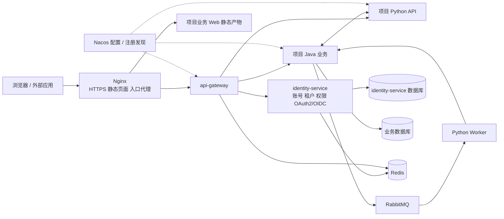

# 总体架构与工程结构设计

> 文档版本：1.15；文档集基线：D-20261029-01；更新：2026-10-29。  
> 项目基础管理后台：平台管理员配置租户、完整用户资料、树形用户组、角色和业务权限，配合审计及监控；面向 PC，客户业务页面由项目开发。组织/授权归[设计04](04-多租户与权限体系设计.md)，开放 OAuth/Bearer 接口归[设计05](05-认证与OAuth2设计.md)，操作流程归[设计06](06-身份管理界面设计.md)。本轮直接采用新库最终模型，不做旧版本兼容或数据迁移，验证见[本轮计划](../plans/2026-10-28-项目基础管理后台与开放接口改造-plan.md)。
> 本轮实施与验证：[身份管理台改造计划](../plans/2026-10-28-身份管理台定位与租户管理改造-plan.md)。
> 状态：已确认的目标设计；不代表代码、脚本、镜像或运行能力已实现。  
> 本文负责：框架范围、模块、技术选型、工程目录、发行物和项目所有权。  
> 导航：[文档总入口](../01-文档导航.md)；本次开发基线见[实施计划](../plans/2026-10-27-编码规范与新项目开发基线-plan.md)；前轮流量保护任务与证据见[实施计划](../plans/2026-10-27-限流熔断与并发保护-plan.md)；历史混合接入见[原计划](../plans/2026-10-27-混合项目接入与审查修正-plan.md)。

本文定义目标合同，不记录逐任务进度。已有交付与本次变更的实际验证范围分别见对应实施计划，不能仅凭设计正文推断某个发行已验收。

| 章节 | 阅读目的 |
| --- | --- |
| [1. 目标、适用项目与范围](#scope) | 目标、适用项目与范围 |
| [2. 需求来源、设计决定与待确认边界](#decisions) | 需求来源、设计决定与待确认边界 |
| [3. 总体架构与运行链路](#topology) | 总体架构与运行链路 |
| [4. 技术选型与兼容基线](#technology) | 技术选型与兼容基线 |
| [5. 模块职责、复用方式与约束](#modules) | 模块职责、复用方式与约束 |
| [6. 框架仓库目录](#framework-layout) | 框架仓库目录 |
| [7. 新项目目录与文件所有权](#project-layout) | 新项目目录与文件所有权 |
| [8. 业务服务内部目录与职责](#service-layout) | 业务服务内部目录与职责 |
| [9. 框架发行物与依赖方式](#artifacts) | 框架发行物与依赖方式 |
| [10. 维护边界与基线升级](#ownership) | 维护边界与基线升级 |

## 1. 目标、适用项目与范围

每个项目独立部署、独立数据库与租户。每个租户拥有独立账号；相同用户名跨租户不代表同一个账号。Java 承担平台与常规领域业务，Python 承担算法、AI Agent，也可独立承担领域服务。默认多机 Docker Compose，不引入 Kubernetes 或自研发布控制台。

框架运行服务只有 identity-service 和 api-gateway；公共包为 java-sdk、python-sdk。身份服务内置管理界面，不要求项目复制管理页、安装管理 npm 包或实现菜单权限。业务前端自行决定页面与按钮表现，后端始终做最终权限检查。

商城、支付、CRM、复杂部门/岗位数据授权、跨项目统一账号、可视化 Agent 编排平台不属于框架范围。当前数据范围固定 SELF/TENANT；没有对象的操作使用不适用范围。第三方组件的维护是交付的一部分，应用多副本不等于数据库或入口已高可用。

## 2. 已确认范围与边界

2026-10-27 用户确认精简计划与评审修正并授权实施，旧计划的全部阶段授权冻结。以下是最终职责，不承诺将移除的功能逐步补回。

| 事项 | 决定 |
| --- | --- |
| 项目与身份 | 独立项目部署、每租户独立账号、PG；identity-service 集成 Spring 成熟认证组件 |
| 通用基础 | identity-service、api-gateway；java-sdk、python-sdk；固定身份管理页面 |
| OAuth | 对外 OAuth2/OIDC、第三方登录、机器认证全部保留；不叠加第二套 IAM |
| 管理能力 | 平台管理员与受保护租户管理员；普通业务角色无管理权；无管理委派和授权模拟器 |
| 账号开户 | 管理员开户、首次改密与重置；公开自注册/邀请/邮件激活另案，不留占位接口 |
| 安全策略 | 项目统一策略；保持密码保护、会话隔离、撤权及审计，取消租户覆盖 |
| 业务边界 | Agent/聊天/算法任务、模型预算、检查点、工具账本均归具体业务项目，框架不实现 |
| 消息 | 可选 AMQP/JSON 与 Outbox/Inbox 事务适配；不影响纯 HTTP 接入 |
| 运维 | 多机 Compose、Ansible、Nginx、Flyway/Alembic；固定入口，不建发布控制台或通用编排引擎 |

历史 R-01 委派、R-03 模拟已退役；R-02 邀请/开放注册移出当前交付。历史事实保留在冻结计划与源码快照，不再作为活跃设计。真实提供方、服务器和容量输入缺失时对应验收保持未验证。

## 3. 总体架构与运行链路

图中的 Worker 属于项目 Python 工程，和 API 可以使用同一镜像、不同启动命令。它不是框架新增的第三个基础服务。Python 需要持久化自己的业务数据时再配置独立数据库；纯计算 Worker 不强制接库。

| 单元 | 提供什么 | 不承担什么 |
| --- | --- | --- |
| Nginx 部署组件 | HTTPS、同源静态页面、转发到固定 Gateway 入口、连接与请求大小限制 | 不直接发现业务实例，不实现用户/租户/角色授权 |
| `java-sdk` | Java 自动配置与公共约定：身份、租户、权限、错误、HTTP、DB、MQ、日志 | 不放项目订单、文档、课程等业务对象；不成为独立进程 |
| `identity-service` | 租户账号、平台运维账号、角色权限、OAuth2 授权服务器、第三方登录、审计 | 不执行算法，不充当所有业务的数据库，不成为全局任务中心 |
| `api-gateway` | 统一入口、显式路由、浏览器 BFF、入口限流、转发和追踪 | 不替代业务服务最终鉴权，不直接操作业务表 |
| `python-sdk` | Python 统一接入包：配置发现、身份校验、租户上下文、HTTP、可选 DB/MQ 集成 | 不封装一套自有 ORM，不绑定某个 Agent 框架，不强制启动 Worker |
| 项目服务 | 领域数据、业务规则、业务权限落点、任务状态与算法 | 不复制用户密码库，不直接读写 identity-service 表 |

Redis、PostgreSQL、Nacos、RabbitMQ 是运行依赖，和“基础服务数量”分开计算。减少源码模块并不意味着可以省略这些组件的维护工作。

## 4. 技术选型与兼容基线

| 能力 | 目标选型 | 原因及使用边界 |
| --- | --- | --- |
| Java | JDK 21、Maven Wrapper | 一致的语言与构建基线 |
| Java 框架 | Spring Boot 4.0.x、Spring Cloud 2025.1.x、Spring Cloud Alibaba 2025.1.x | 按官方匹配系列组合，不混搭 BOM |
| 认证与授权协议 | Spring Security 7.0 系列的 OAuth2 Authorization Server、OAuth2 Client、Resource Server | 同一技术体系处理第三方登录、对外 OAuth2/OIDC 和资源服务认证，集成在 identity-service |
| Java 流量治理 | Sentinel 1.8.9（SCA BOM） | 官方并发流控与熔断，Nacos 原生规则动态更新；不增加治理服务 |
| Gateway | Spring Cloud Gateway WebFlux | 与 Java 配置发现及 OAuth2 Client 集成；必须使用响应式适配 |
| Java 数据访问 | MyBatis-Plus，匹配 Boot 4 的 Starter；Flyway | 熟悉的 mapper 分层；迁移版本化 |
| Python | Python 3.12、uv、FastAPI、Pydantic 2、HTTPX | 标准工具管理包、类型验证和 HTTP |
| Python 数据访问 | SQLAlchemy 2 + psycopg 3、Alembic；按需启用 | 业务需要持久化时才引入 |
| 配置与发现 | Nacos 3.x；Java 使用 SCA；Python 使用官方 Nacos Python SDK 3.x | 两种语言使用同一服务目录和配置中心 |
| 数据库 | PostgreSQL 17，发布时选择该主版本受支持的补丁 | 每服务独立数据库与账号，可共用数据库实例；启用 RLS |
| Redis | Redis 7.2 兼容基线，锁定发行镜像与许可证 | 登录会话、BFF 会话、限流；业务缓存按需用；不承担可靠业务消息 |
| 消息 | RabbitMQ 4.x；Java Spring AMQP；Python aio-pika | 共享 AMQP 与 JSON 合同；不让 Java 模拟 Celery 私有任务协议 |
| 文件 | S3 API；标准服务端 SDK | 供应商由项目部署选择；跨主机文件使用对象存储，不传本机路径 |
| 观测 | 结构化日志、Micrometer / Prometheus 指标、OpenTelemetry 链路 | 默认输出标准信号，采集和展示可接现有运维平台 |
| 管理界面 | Vue 3 + TypeScript + Vue Router + Vite | services/identity-service/admin 为独立应用源码；构建后随身份镜像交付；web 只含业务演示，不依赖管理页面实现 |
| 入口代理 | Nginx 官方镜像，实施计划的兼容冻结任务 锁定受支持版本及 digest | 生产默认入口；证书采用 Certbot 或已有企业证书，管理流程见 [应用部署与运维设计·部署拓扑、主机清单与发布输入](09-应用部署与运维设计.md#topology)；不新增业务微服务 |
| 部署 | Docker 镜像 + Compose v2 | 单机用于开发，多机通过私网可达地址连接 |
| 发布运维 | Ansible / community.docker + Compose | 运维触发统一部署入口；不开发发布控制台，不增加发布服务 |
| 数据库备份 | pgBackRest + 独立备份存储 | 基础备份、WAL 归档与恢复；采用成熟工具，发布前检查备份与恢复记录 |

**OAuth2 带来的选型修订：** 之前 Sa-Token 是集成认证的候选。用户要求完整的 OAuth2 三方向与 OIDC 后，本设计统一使用 Spring Security 授权服务器及客户端组件，不叠加第二套 Sa-Token 会话体系。它仍在 identity-service 内运行，符合已确认的部署结构。Spring Authorization Server 已进入 Spring Security 7 的发布体系；其协议组件可复用，但租户账号、授权策略、管理界面和数据存储集成仍由框架实现。[Spring 官方说明](https://spring.io/blog/2025/09/11/spring-authorization-server-moving-to-spring-security-7-0/)

上述版本是选定的兼容系列，不是已经通过联调的完整依赖锁。实施计划的兼容冻结任务 必须冻结确切补丁版本、镜像 digest 和许可证清单，验证 Gateway、授权服务器、ORM 和 Python Nacos SDK 后再发布。不能把“组件分别支持”写成“组合已经生产验证”。官方 SCA 对应表列出 Boot 4.0 / Cloud 2025.1 / SCA 2025.1 的匹配关系。[SCA 版本表](https://sca.aliyun.com/en/docs/2025.x/overview/version-explain/)

2026-10-28 Java 依赖安全补丁：保持 Boot 4.0.9、Cloud 2025.1.4、SCA 2025.1.0.0 和 springdoc 3.0.3，父 POM 明确锁定 HttpClient 5.6.4 / HttpCore 5.4.3（上游配套版本），覆盖 TLS 主机名校验和头部资源限制漏洞；Swagger UI WebJar 升至 5.34.0，内嵌 DOMPurify 3.4.16。避免为静态资源补丁切换到要求 Boot 4.1 的 springdoc 3.1。修复依据及定向验证见[整体整改计划的 CI 故障修复记录](../plans/2026-10-28-编码审查整体整改与规范落地-plan.md)。这些补丁不改变框架公共 API，运行兼容性仍以实际测试范围为准。

**复用成熟实现，自己只做统一接入：** 不重写 OAuth2 密码学、不重写 Nacos SDK、不重写 HTTP 客户端、不自建消息中间件。我们需要维护的内容是租户/权限业务模型、框架配置、公共上下文、统一错误与少量适配，以及能真正使用它们的项目示例。

## 5. 模块职责、复用方式与约束

| 参考点 | 我们的采用方式 |
| --- | --- |
| 芋道 system 模块集中提供用户、租户、角色和权限 | 保留，不按这些实体拆服务 |
| Java controller / service / dal 分层 | 保留，以业务子包组织 |
| 公共框架与业务代码分离 | 保留，通过版本依赖复用 |
| 多个业务模块和大量技术 Starter | 本设计压缩为一个 Java 公共模块，内部按包和条件自动配置组织 |
| 租户上下文及数据库过滤 | 增加 PostgreSQL RLS 与跨语言测试；不能只靠入口 header 或某个 ORM 插件 |
| 部署示例和代码生成 | 采用可运行项目示例；多机网络、迁移和服务鉴权自行补齐 |

不把上游演示配置直接视为生产配置，不默认信任 `login-user` 等明文身份头，不把“加了 tenant_id”当成所有数据已隔离，也不把 RabbitMQ 发布成功当成业务已完成。借用上游源码时记录固定提交及许可证归属，保留必要声明；本设计并不要求整体 Fork。

参考入口：[芋道 Cloud 仓库](https://github.com/YunaiV/yudao-cloud)。该项目在本设计中是组织方式参考，本文所有接口、表名和目录均为我们的拟定合同，不宣称是上游原样实现。

独立项目部署、租户独立账号、两个基础服务、身份服务内集成完整 OAuth2/OIDC、PostgreSQL 隔离、统一样例源码、按服务拥有数据库和迁移均保持。Keycloak/Casdoor 只用于讨论产品模型，当前不集成或部署它们。

局部类名、索引名称、格式化细节可以在实施中确定；精确依赖补丁与镜像 digest 必须通过兼容验证冻结。兼容验证失败时反馈具体证据并修订设计，不擅自更换整套技术栈或放宽安全行为。

## 6. 框架仓库目录

维护仓库以 sdk/java、sdk/python、services、config、infra、deploy、web、scripts、tests、docs 为职责目录；services 包含两基础服务与两个可运行样例，配置与 Ansible 在根 config/infra/deploy。所有内容只有一份，不保留 template、scripts/templates 或 manage.py。

公共模块测试留在所属模块；工具/集成测试在 tests，生成项目只携带与自身行为相关的测试和规范，不复制历史验收材料。完整布局与所有权唯一见[源码目录](11-源码脚手架交付与开发体验设计.md#layout)。

## 7. 新项目目录与文件所有权

scripts/create.py 从固定提交导出独立源码项目。SDK、身份、网关和初始双语业务直接归主仓；后续业务可使用主仓local源码或固定Git submodule。目录和文件所有权唯一见[脚手架目录](11-源码脚手架交付与开发体验设计.md#layout)，不再维护第二份项目树。

Java 根 POM 聚合 sdk/java、基础服务及业务；Python 每服务独立环境，以 ../../sdk/python 引用本项目 SDK。普通业务不跨服务引用内部源码。新项目无需框架 checkout 或私有包仓库；公共源码升级通过补丁评审，子仓升级固定 gitlink，不自动合并。

## 8. 业务服务内部目录与职责

每个 Java 业务服务使用 src/main/java/项目包 下的 controller/dto、service、dal、client；JDBC 的具体 Repository 可直接放 dal，简单只读业务投影可放 model（不代表强制 ORM），只有使用相应 ORM/MyBatis 时才增加 dataobject/mapper，有消息需求时才增加 mq；迁移放 src/main/resources/db/migration，权限清单放 src/main/resources/permissions.yaml。启动类与领域包位于服务自身工程，不新增 api/biz/server 三套部署模块。

Python 每服务在 src/业务包 下按需要设置 api、schemas、services、repositories、clients；main.py 负责应用装配，config.py 保存业务设置。仅实际使用 ORM 时增加 models；agents/tasks 属于有此需求的业务项目，不是框架默认结构；迁移放工程根 migrations，权限清单放 src/业务包/resources/permissions.yaml 并声明为包资源。模型供应商适配放 clients，Agent/算法编排放 agents/services。只建立真实用到的目录，不要求纯 HTTP 服务有 ORM/Worker。

编排层处理用例，DAL/Repository 处理持久化，Client 处理外部调用。规范文档约束依赖方向与命名，示例及指南引用本节路径；变更位置先更新本节，再同步包资源构建、发行清单和指南。

## 9. 框架发行物与依赖方式

脚手架发布固定 Git 标签/提交，创建读取该快照；项目按自己的源码提交构建镜像与部署包。后续业务子仓的 path/URL/commit 进入发布来源记录。SDK 本地 Maven reactor/uv 源码依赖，不要求私服。构建、打包与不可变镜像见[发布合同](11-源码脚手架交付与开发体验设计.md#deployment)。

Maven wrapper 使用 LF，mvnw 在 Git 为 100755；创建不安装依赖或自动提交。模板派生服务名、路由、权限、scope 和测试；不将所有项目绑定到原示例名称。类型化调用仍为独立已知缺口，OpenAPI 不等于契约兼容性检查。

## 10. 维护边界与基线升级

框架维护脚手架公共源码、基础服务、scripts 和根样例；生成项目拥有并维护其全部源码与实例声明。规范复制到项目 docs/standards，状态写 .local，部署包只带运行载荷，不带业务开发源码和历史计划。

升级以 gitlink 为唯一源码基线：切换固定提交、调整必要 Maven/SDK 版本、重锁受影响服务、运行定向验收，一起提交。禁止更新浮动 main 或重生成覆盖业务。运行发布另用 deploy/release.yaml 固定镜像 digest、源码、锁与迁移摘要，不再维护重复的 framework-baseline。已有制品项目按一次性人工转换清单保留原名、卷、租户账号、权限及数据库，不运行新项目初始化。

参考资料：以下为组件参考资料；本次只重新核验了认证文档新增引用的 Spring 客户端模型与 NIST 密码建议，其余在线版本未重新核验。框架具体默认策略由本文定义，不能认为引用组件就自动实现了全部业务合同；实施兼容冻结任务须复核版本与能力。

| 来源 | 参考用途 |
| --- | --- |
| [芋道 Cloud](https://github.com/YunaiV/yudao-cloud) | Java 公共能力与 system 模块组织的参考 |
| [SCA 版本关系](https://sca.aliyun.com/en/docs/2025.x/overview/version-explain/) | Boot / Cloud / SCA 必须按匹配系列管理 |
| [MyBatis-Plus 安装](https://baomidou.com/en/getting-started/install/) | 使用对应 Spring Boot 版本的 Starter |

- 2026-10-27，D-20261027-03：统一混合项目目录及接入路径；业务配置扩展、管理页和发布恢复合同按计划 05 修正；实际验收见计划 05。

- 2026-10-27，D-20261027-04：按已确认 Sentinel 计划同步原生网关、Java 动态规则、Python 并发和调用边界；目标合同不代表已完成运行验收。

- 2026-10-27，D-20261027-05：用户确认编码规范与新项目开发基线计划；明确按需服务目录、JDBC Repository 合法位置，以及规范/检查/业务测试随发行交付；运行协议保持。

- 2026-10-27，D-20261027-06：按源码工作区计划修订项目创建、来源、初始化与交付边界；验收见该计划，历史结果不追改。

- 2026-10-27，D-20261027-07：按用户确认重组框架源码、模板、工具和测试目录；统一 manage.py，退役重复的制品复制器；运行行为不扩大，Docker 验收暂停。

- 2026-10-27，D-20261027-08：按用户确认修正 Linux 入口权限、生成文件归属与发布操作顺序；运行合同不扩充，Docker 验收仍暂停。

- 2026-10-28，D-20261028-03：CI 审计恢复后修订 HttpComponents 与 Swagger UI 安全补丁基线；保持主要框架兼容系列，不扩大为生产验收。

修订：2026-10-28，D-20261028-04：身份管理台面向研发及技术管理员；平台显式选择租户管理身份，规则见[多租户设计](04-多租户与权限体系设计.md#delegation)，页面见[界面设计](06-身份管理界面设计.md)。客户业务后台继续由具体项目实现。固定平台客户端增加 platform.identity scope，既有会话重新授权后取得新能力；不改变业务用户 token 租户和授权交集。

修订：2026-10-28，D-20261028-05：内置管理后台只供平台管理员使用；受保护租户管理员及其 API 能力保留，业务项目自行提供对应界面。平台目标管理、业务租户认证和数据隔离规则不变，入口定义见[界面设计 §2](06-身份管理界面设计.md#delivery)。

修订：2026-10-28，D-20261028-07（已确认）：项目基础后台增加完整通用用户资料、树形组织/用户组、手工权限目录及独立应用 API 接入；后台只供平台管理员、PC 使用。按用户要求采用最终空库模型，不做旧数据迁移或兼容适配。实现和定向验证见[本轮计划](../plans/2026-10-28-项目基础管理后台与开放接口改造-plan.md)。

修订：2026-10-29，D-20261029-01：后续服务可选同仓local或固定submodule；具体生成登记规则归设计11，分页合同归设计07。本轮实际结果见API与交付实施计划。
