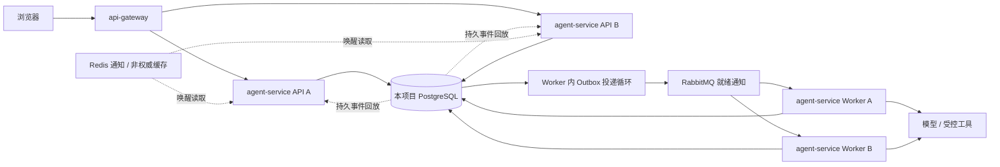

# 聊天Agent多节点设计

> 文档版本：1.1；文档集基线：D-20261026-03；更新：2026-10-26。  
> 状态：目标设计，待整体评审；不代表代码、脚本、镜像或运行能力已实现。  
> 本文负责：聊天 API/Worker 的分布式运行、状态合同、恢复及框架与业务分工。  
> 导航：[文档总入口](../01-文档导航.md)；任务与证据见[实施计划](../plans/01-微服务框架实施计划.md)。

文中的路径、接口、配置和命令均为拟交付合同；当前仓库只有文档，不能直接执行这些命令启动系统。

| 章节 | 阅读目的 |
| --- | --- |
| [1. 部署角色与数据归属](#architecture) | 部署角色与数据归属 |
| [2. 框架提供什么、业务实现什么](#responsibilities) | 框架提供什么、业务实现什么 |
| [3. Run、会话、消息与接口](#model) | Run、会话、消息与接口 |
| [4. 排队、并发、租约和旧 Worker 隔离](#scheduling) | 排队、并发、租约和旧 Worker 隔离 |
| [5. 流式事件、重连与跨 API 回放](#streaming) | 流式事件、重连与跨 API 回放 |
| [6. 检查点、工具、审批与取消](#recovery) | 检查点、工具、审批与取消 |
| [7. 容量、版本兼容与可观测性](#capacity) | 容量、版本兼容与可观测性 |
| [8. 新项目接入和节点配置](#integration) | 新项目接入和节点配置 |
| [9. 关键故障的验证场景](#fault-tests) | 关键故障的验证场景 |

## 1. 部署角色与数据归属

聊天项目采用 `agent-service`，同一工程、同一发行镜像提供 `api` 和 `worker` 两种启动角色。API 负责 HTTP、鉴权、会话请求与 SSE；Worker 负责 Agent 执行、模型和工具调用。运行角色可以独立增加副本，不新增会话服务、检查点服务、调度服务或消息推送服务。

API 在 Nacos 注册同一个 `agent-service` 名称，实例地址不同；Gateway 使用发现与负载均衡。纯 Worker 不作为 HTTP 目标注册进 API 实例列表，以免网关把用户请求发给没有 API 的进程；实例状态通过 Worker 心跳和指标展示。Worker 间由队列通知和数据库原子领取协调，不由 Nacos 分配会话。

聊天 API、Worker 共享本项目 agent 数据库，这是同一服务不同运行角色共享本服务数据，不是跨服务共库。`identity-service` 仍只管身份与授权，不存聊天历史或 Agent 检查点。基础设施沿用 PostgreSQL、Redis、RabbitMQ、Nacos，不为聊天增加新中间件种类。

多节点接入不依赖会话粘滞。API A 可以提交消息、Worker B 执行、API C 接收流式重连；已经建立的 SSE/TCP 连接本身不会迁移。多副本是应用容错基础，不自动使共享数据库、消息服务或模型提供方高可用。

## 2. 框架提供什么、业务实现什么

| 能力 | 框架明确交付 | 业务项目负责 |
| --- | --- | --- |
| 身份与租户 | 框架身份服务、SDK 校验、RLS 事务上下文；受限的后台委托检查接口 | 会话归属、角色映射、共享会话是否允许；标准示例只允许所有者访问聊天正文 |
| Run 调度 | SDK 的 RunStore/RunCoordinator：排队、领取、租约、代号校验、取消、超时与就绪扫描 | 注册 Agent 执行函数及任务策略，不自行再写另一套状态机 |
| 对话业务 | 示例中的 conversation/message schema、路由、所有者检查和最小聊天页 | 会话标题、附件、历史保留、上下文截断、引用、回答展示和领域功能；示例复制后归项目维护 |
| 并发控制 | 同会话串行及跨会话并发的默认实现；消息提交去重 | 若要求打断、分支对话或编辑历史，另行定义产品规则；默认不隐含这些语义 |
| 流式输出 | SDK 的 EventLog 与 SSE 适配：顺序号、持久化、游标回放、心跳、背压；Gateway 流式配置 | 产生面向用户的回答/工具状态事件，前端按协议合并与去重；不输出模型隐藏推理或工具密钥 |
| 检查点 | CheckpointStore、版本校验、租户/attempt 保护；可选 LangGraph checkpointer 适配 | Graph、state schema、状态升级、哪些步骤可安全重放、实际工具结果查询或补偿 |
| 工具与人工确认 | ToolLedger、ApprovalStore、幂等键、确认状态及恢复钩子 | 工具本身、权限与副作用分级、确认内容/确认人、外部系统幂等实现 |
| 限额与观测 | 跨节点容量预占/释放、预算记账接口、统一 Run/事件/检查点指标 | 为本项目和租户配置额度，提供模型单价与用量映射，评估模型效果 |
| 多机部署 | 同镜像双角色的 Compose 模板、优雅退出、双节点故障验收脚本 | 主机、TLS、模型凭证、GPU/推理服务、实际网络与容量验证 |

上述 SDK 能力必须有可运行实现与相关测试，不能只交接口定义要求每个项目重新实现。聊天页面与领域数据模型是可修改的示例代码，不作为 SDK 强制领域模型。默认示例使用 LangGraph；`langgraph` extra 提供适配，基础 `python-sdk` 仍不要求所有项目安装它。

本设计只做必要运行支持，不自建可视化 Agent 编排平台，不替换成熟图执行引擎。LangGraph 的检查点/长期记忆可以复用；其开源库与 Agent Server 的并发输入管理能力有边界，不能把托管平台功能算作已经集成的库能力。[持久化文档](https://docs.langchain.com/oss/python/langgraph/persistence)、[并发输入文档](https://docs.langchain.com/langsmith/double-texting)

## 3. Run、会话、消息与接口

框架技术表由 SDK 附带版本化迁移，在 agent 数据库执行；表名与列为拟新增。运行角色使用本服务受限账号，跨租户调度只授予技术表的专用权限；读取/写入业务消息和 checkpoint payload 必须回到经校验的租户上下文。不得给 Agent 图、工具代码暴露可跨租户调度的数据库连接。

| 数据 | 所有者 | 最小约束 |
| --- | --- | --- |
| `chat_conversation`、`chat_message` | 项目示例，业务可扩展 | tenant_id、owner_user_id；message 保存 conversation_id、client_message_id、content、status；默认按所有者授权 |
| `runtime_session` | SDK | `(tenant_id, conversation_id)` 唯一；next_turn、active_run_id、version；只存调度状态，不存对话正文 |
| `runtime_run` | SDK | id、tenant_id、conversation_id、turn_no、input_ref、request_hash、owner_user_id、delegation_ref、state、attempt、worker_id、lease_until、cancel_requested、resume_count、版本信息、checkpoint_ref、last_event_seq、output_snapshot、预算/截止时间 |
| `runtime_event` | SDK | `(tenant_id, run_id, seq)` 唯一；type、attempt、payload、created_at；带 RLS，不把 tenant_id 仅藏在 JSON 内 |
| `runtime_checkpoint` | SDK | tenant_id、run_id、checkpoint_id、namespace、attempt、schema_version、payload、pending_writes；索引与 RLS 覆盖所有读写 |
| `runtime_tool_call` | SDK | tenant_id、run_id、logical_call_id 唯一；input_hash、tool_version、状态、结果/引用；logical_call_id 重放时不变 |
| `runtime_approval` | SDK | tenant_id、run_id、approval_id 唯一；待批准操作与参数摘要、指定确认主体、decision、version、expires_at |
| `runtime_capacity` | SDK | 项目/租户容量与预算预占记录；并发领取和释放使用固定锁顺序及唯一 run 预占记录 |

所有 UUID 对外为字符串。`attempt` 是单个 Run 内递增执行代号，不是用户 ID；SDK 接管时更新它，旧执行者的续租、事件、检查点和结果写入都必须带旧代号并被拒绝。队列中只带 tenant_id/run_id/执行版本等通知字段，不带用户 token、聊天正文或任意回调地址。

| API（agent-service） | 请求与前置条件 | 返回 / 行为 |
| --- | --- | --- |
| `POST /api/v1/chat/conversations` | `agent:chat` + `chat.write` | 创建当前用户会话；不接受客户端指定 owner_user_id |
| `GET /api/v1/chat/conversations/{id}/messages` | `agent:read` + `chat.read`；检查所有者 | 分页返回持久消息及其完成/取消状态 |
| `POST /api/v1/chat/conversations/{id}/messages` | client_message_id、content、attachment_ids；检查所有者、附件与额度 | 事务写消息、Run、顺序号和 Outbox，202 返回 message_id/run_id；同消息 ID 同内容返回原结果，内容不同 409 |
| `GET /api/v1/chat/runs/{id}` | 读取权限与所有者 | 状态、已提交输出快照、last_event_seq、等待确认信息；不返回内部 checkpoint 或凭证 |
| `GET /api/v1/chat/runs/{id}/events` | 同上；可带 Last-Event-ID | SSE 顺序回放与持续订阅；不会因订阅创建新 Run |
| `POST /api/v1/chat/runs/{id}/cancel` | `agent:cancel` + `chat.write`；所有者 | 幂等记录取消；返回当前状态和 cancel_requested，不虚报已停止 |
| `POST /api/v1/chat/runs/{id}/approvals/{approval_id}` | decision=approve/reject、expected_version；`agent:approve` + `chat.write`；指定确认人 | 事务校验待确认操作、版本、有效期；一次性消费确认；冲突 409、已过期 410 |
| `POST /api/v1/chat/runs/{id}/recover` | action=resume/abandon、reason、expected_version；`agent:recover` + `chat.manage` | 只允许当前租户授权恢复人员；不隐式授予读取全部聊天正文的能力；不确定副作用未查明时不得 resume |

示例权限清单包含上述五个权限，read/chat/cancel/approve 默认 SELF；recover 允许 TENANT，但操作与内容读取分开。客户服务后台如要读租户聊天正文，必须另行设计授权，不能沿用文档管理员的 TENANT 规则自动开放。

SDK 的 `RunCoordinator.submit` 与项目写入用户消息共用一个数据库事务；`claim/heartbeat/append_events/save_checkpoint/complete` 共用同一服务内库接口，不要求 API/Worker 为了互相访问而新增内部网络微服务。

后台委托由 `identity-service` 提供两个受限接口：

- `POST /internal/v1/delegations`：agent-service 使用面向身份服务的机器凭证认证，提交当前请求的 subject_token、目标操作/scopes、request_key 和业务资源引用；subject_token 是需单独验证的数据，不能把机器主体当成用户。身份服务校验原 token、其目标 audience、租户、client 及权限，生成绑定原授权记录、用户、租户、目标服务和 scopes 上限的 delegation_ref。同一 request_key/主体/输入幂等返回原引用，输入不一致拒绝。
- `POST /internal/v1/delegations:check`：只有被登记的 agent-service 机器客户端可提交 delegation_ref、permission、操作类型；服务端核对绑定的目标服务、租户/用户状态、原授权撤销状态和当前权限，不接受调用者任意拼接用户/租户身份。返回 allowed、稳定 reason_code 和权限/数据范围上限；依赖不可用返回 503，不能返回 allowed=true。

委托创建在提交 Run 的数据库事务之前；事务失败形成的未绑定委托按有效期清理，不产生可独立发起任意业务的凭证。Run 仅保存引用，不保存用户 token；身份服务存储委托关联记录，正文与消息只留在项目库。委托最长 24 小时且不超过原授权的存续期限，人工批准时须以确认人当前授权重新核验/建立所需委托，再原子消费 approval；过期或撤销的委托不能直接续用。

执行权限取提交时上限与用户当前权限交集。10 分钟 access token 自然过期不自动取消仍在授权有效期内的后台 Run，但撤销对应授权、退出撤销、禁用或权限收回会阻止后续操作；没有用户委托的机器 token 不能读取任意聊天历史。涉及外部请求的权限检查在数据库事务外完成，进入写事务时重查相同 Run/version 与绑定对象，不能拿另一 Run 的检查结果复用。

## 4. 排队、并发、租约和旧 Worker 隔离

1. **提交事务：** 先完成事务外鉴权，再按项目容量、租户容量、runtime_session 的顺序锁定记录，分配递增 turn_no；以 `(tenant_id, conversation_id, client_message_id)` 唯一约束去重，写用户消息、Run=QUEUED 与 Outbox。默认每会话最多排队 10 个，超过返回 429；重复请求不再次占额度。
2. **领取事务：** 在事务外检查候选 Run 的委托权限，再按项目容量、租户容量、session、候选 Run 的顺序锁定；重查候选版本/归属与刚才验证的对象一致，只允许最早未完成 turn 领取；active_run_id 为空或属于本次待恢复 Run。核对执行版本并预占容量，生成新 attempt，记录 worker/lease，转 RUNNING。多个 Worker 同时领取只允许一方成功；DB 锁期间不得执行远程内省或模型请求。
3. **上下文冻结：** 业务项目在该 turn 开始时构造上下文，只包含此前已完成/明确处理的轮次和本次用户消息；排队中的后续消息不能进入当前模型输入。SDK 保存 input/context revision 及 Agent/提示词/工具版本，恢复时使用相同快照。
4. **执行提交：** 每次技术状态写入锁 Run，核对 state、attempt、worker 与未过期 lease；再提交事件/检查点/结果。不能先写 LangGraph checkpoint 再异步检查 attempt。
5. **交接下一轮：** 正常终态提交按相同的项目容量 → 租户容量 → session → Run 锁顺序，写最终消息/状态/终态事件；仅当 active_run_id 属于本 Run 时释放该槽，容量按唯一预占记录释放一次，同事务通知下一条可运行 Run。取消排队中的后续消息不得清掉当前执行者的槽。FAILED/CANCELLED 的输出标记为未完成，不把半条答案当作正常历史。仅追加事件/续租时可单独锁 Run，但持有 Run 锁后不得再反向获取容量/session 锁。

MQ 只通知有就绪工作，不作为顺序事实来源。非队首/已领取的重复通知可以 ack；前一轮终结会重新发就绪通知，数据库扫描器每秒补捞就绪 Run，避免一次丢失通知导致永远不执行。数据库扫描不替代 Outbox 的可靠发布。

WAITING_APPROVAL 和 RECOVERY_REQUIRED 仍占该会话的活跃槽，阻止后续消息越过未决上下文，但释放计算容量。默认采用“排队 + 显式取消”，不自动打断、不自动回滚整个对话。人工放弃未决 Run 后才能继续下一轮。

## 5. 流式事件、重连与跨 API 回放

本设计选择 **PostgreSQL 事件日志作为回放事实来源，Redis Pub/Sub 只用于唤醒读取**。不同时维护 RabbitMQ、Redis Streams、数据库三套流式日志。Redis 通知丢失时，API 通过最长 1 秒的兜底查询读取新事件，不能依赖 Pub/Sub 不丢消息。[Redis 的投递语义](https://redis.io/docs/latest/develop/pubsub/)

- Event envelope：run_id、seq、type、attempt、message_id（适用时）、payload、created_at。SSE `id` 为 `<run_id>:<seq>`；身份与租户不来自此 ID，订阅必须独立鉴权。
- Worker 将文本按最多 100ms 或 8KiB 的批次合并，先持久化事件再通知 API 推送；这一规则是实现目标，需要负载验证，不宣称端到端延迟保证。内存中尚未提交的文本不先发给用户。
- 同一追加事务更新 Run 的用户可见 output_snapshot 与 last_event_seq；快照查询在同一一致性视图读取二者，保证清理历史事件后仍有完整的已提交输出。SDK 只投影标准消息/状态事件，领域扩展的展示数据由项目提供受控映射，不能把 checkpoint 原样当快照返回。
- 事件类型固定为 `run.started`、`message.delta`、`message.completed`、`output.reset`、`tool.started`、`tool.completed`、`run.waiting`、`run.completed`、`run.failed`、`run.cancelled`、`run.recovery_required`。工具事件只含可展示状态，不能携带凭证或隐藏推理。
- API 按 `seq > cursor` 分页读取；每个订阅独立游标，多窗口都可看到完整事件，不使用竞争消费方式分掉输出。前端按 run_id/seq 去重，按 attempt 分辨重生成。
- 鉴权后校验游标属于请求 run_id、seq 非负且不大于当前已提交序号；非法游标返回 400，不等待一个不存在的未来序号。首次订阅从 0 开始，仍需遵守事件保留边界。
- API A 故障后，浏览器携带游标重连至 API B；B 重做鉴权，读取日志补发。重连不得再次调用提交消息接口，不得产生新模型费用。
- 活跃 Run 的事件不清理；终态后默认保留 24 小时。游标早于保留下界，建立流前返回 410 `EVENT_CURSOR_EXPIRED`；客户端查询快照与 last_event_seq 后重新订阅。聊天记录/快照按项目的数据保留政策另行管理，不随 SSE 日志清理丢失。
- 无事件时 15 秒发送 SSE 注释心跳；客户端待发送缓冲上限 1MiB，超限断开该慢连接并允许回放，不阻塞 Worker。连接在收到终态且补齐事件后关闭，前端停止自动重连。

Gateway 只对 `/api/v1/chat/runs/*/events` 采用流式路由：禁用响应聚合/缓冲及整段重试，idle timeout 45 秒，服务端单连接最长 10 分钟并受当前认证期限限制；普通 API 保留短请求超时。退出、扩容或最长连接时间到达后由客户端重连，不能在另一节点“接走”原 TCP 连接。SSE 的 Last-Event-ID 是游标协议，服务端持久化与回放由本设计实现。[SSE 标准](https://html.spec.whatwg.org/multipage/server-sent-events.html)

默认聊天前端通过同源 BFF cookie 及成熟 fetch/SSE 解析器接入；不能假设浏览器原生 EventSource 可以设置任意 Authorization header。连接建立前检查权限，建立后每 30 秒重新检查，事件读取前遇到已知撤权立即停止；依赖故障或撤权时发送不含敏感数据的流错误并关闭。流已经开始后不能伪称再返回 HTTP 401/503；建立前才使用这些状态码。最长 30 秒是已建立订阅的撤权检查窗口，不等于普通 API 的实时内省边界。

## 6. 检查点、工具、审批与取消

**与算法任务的区别：** 本节只定义聊天 Run；排队超时为 FAILED/QUEUE_TIMEOUT，终态按调度合同释放槽位/推进下一轮。[算法任务](07-Java与Python协作设计.md#analysis-jobs)排队超时保留为 RECOVERY_REQUIRED，等待显式恢复。两者不共用状态处理器。

聊天独立配置名为 agent_runtime.lease_seconds=120、heartbeat_seconds=30、execution_timeout_seconds=1800、queue_timeout_seconds=3600；本节是这四个值的唯一来源。心跳小于租约，类型配置随 Run 冻结；运行中的 deadline 不被后续 Nacos 修改追溯延长。

检查点保存可继续执行的 Graph 状态；事件日志保存用户已经看到的输出。两者不能互相代替。默认示例的 LangGraph thread_id 由服务生成并映射到 run_id，同一 Run 恢复沿用它；跨轮会话记忆由项目根据持久消息构造，不允许前端指定任意 checkpointer thread_id。

可选 LangGraph adapter 使用 SDK 的 CheckpointStore，按上游 checkpointer 合同保存状态、版本、namespace 和 pending writes。写入必须在核对 Run attempt/lease 的同一事务内完成；读写都带 tenant_id，并使用受控结构化序列化，不接受外部 pickle。不能把未加租户和代号保护的裸 PostgresSaver 直接交给项目并宣称多节点安全。适配器的上游精确版本与接口兼容在实施计划的 Agent 适配任务中冻结和验证。

| 状态 / 故障 | 处理合同 |
| --- | --- |
| QUEUED | 等待队首与额度；排队截止取 queue_timeout_seconds，超限转 FAILED，原因 QUEUE_TIMEOUT |
| QUEUED → CANCELLED | 用户显式取消，或领取前确认授权已撤销；只释放属于本 Run 的资源，不影响其他正在运行的轮次 |
| RUNNING | 租约/心跳取 lease_seconds/heartbeat_seconds；累计执行预算取 execution_timeout_seconds，可按 Agent 类型受控配置 |
| RUNNING → WAITING_APPROVAL | 同事务保存 checkpoint、待确认操作与 waiting 事件，释放执行租约/容量并使旧 attempt 失效；不占着协程等人 |
| WAITING_APPROVAL → QUEUED | 有权限的指定确认人批准当前 approval/version；同事务消费确认并写就绪 Outbox；保留会话槽，下次领取使用新 attempt |
| WAITING_APPROVAL → CANCELLED | 拒绝、用户取消或默认 24 小时确认期限到达；释放会话槽；迟到批准不恢复执行 |
| RUNNING 租约失效 | 扫描器使旧 attempt 失效；先进入 RECOVERY_REQUIRED；不因收到重复 MQ 就直接运行 |
| RECOVERY_REQUIRED → QUEUED | 仅预先声明可恢复、版本兼容、无不确定副作用且授权仍有效的 Run 可自动恢复；最多 1 次；否则要求受控人工判定 |
| RUNNING → SUCCEEDED / FAILED / CANCELLED | 状态、最终消息和终态事件同事务提交；后续结果不可覆盖；取消与完成通过行锁决胜 |

自动恢复能力由项目的执行适配器预先声明，不能让 LLM 自己判断“可以重试”。标准示例的确定性假 Agent 和只读检索步骤允许安全恢复；有未知结果的外部写操作默认禁止自动恢复。Graph/schema/工具版本不匹配时保持待恢复，不强行用新代码解析旧状态。

每个外部工具调用在执行前写 `logical_call_id`、input_hash、tool_version 和 STARTED，成功后保存结果。重放规则：

logical_call_id 来自已持久化的工具调用计划（例如保存后的模型 tool-call ID 与步骤序号），不能在每次 attempt 临时重新生成。调用意图未落库不得发送外部请求；恢复时找不到原计划或无法确定同一逻辑调用，必须停止自动恢复，不能猜测后再调用。

1. 已有 SUCCEEDED 且输入一致：复用结果，不再次调用。
2. STARTED 但结果未知：先由项目工具查询外部结果，或使用相同幂等键重试；外部不支持时保留 RECOVERY_REQUIRED。
3. 同一 logical_call_id 输入变化：拒绝，不能以重试名义执行另一操作。
4. lease 失效或 cancel_requested 后不得开始新工具；已经发出的外部请求不保证能取消，仍需查证结果。API/数据库中的 fencing 不能阻止一个不支持幂等的外部系统重复产生副作用。

模型流式连接中途丢失通常不能从最后一个 token 原样接续。允许重生成当前模型步骤时先持久化 `output.reset`，指明作废的部分输出/attempt；前端替换未完成的回答段，再显示新内容，不能直接把两次不同生成拼接起来。已完成且有检查点的步骤复用；可能发生额外模型费用，不宣称每个 token exactly-once。

取消操作写共享状态，Worker 在心跳、步骤边界和每次外部工具前检查；关闭页面只停止订阅，不默认取消。人工确认绑定操作输入摘要和当前版本，重复同一批准返回原结果，批准后不得修改参数。恢复人员需要说明查证依据，不能仅点击“重试”绕过不确定副作用检查。

## 7. 容量、版本兼容与可观测性

默认配置作为示例默认值：每租户最多 2 个运行 Run、每项目最多 8 个、每 Worker 最多 2 个；每会话排队最多 10 个、每租户 QUEUED 最多 20 个。由 PostgreSQL 容量记录事务预占/释放，按固定的“项目 → 租户 → 会话 → Run”锁顺序访问，避免节点分别计数而超额。预算不足返回 429/明确业务错误，不以 Redis 不可用为由无限放行；Redis 限流仅作为入口优化。

调度按租户轮转选择可运行的会话队首，每轮每租户最多新增一个领取；额度不足的通知不持续热循环重投，保持 QUEUED 并由就绪扫描重新调度。项目须配置模型请求/ token 额度与每 Run 预算，SDK 提供原子预占/结算接口；每次模型请求按剩余预算限制输出。费用未知的失败请求保留未结算预占并审计，不默认全额退回造成预算绕过。

Run 数量限制针对受调度的逻辑任务，不能证明失联节点上的外部模型请求已物理停止。模型调用还需调用级并发/速率预占；结果未知时不立即释放这部分预占，由提供方查询结果、可靠执行截止或人工处理确认。不能为了恢复任务而无条件清空旧调用占用并承诺供应商侧绝不超并发。

Run 固定 agent_version、graph_version、prompt_version、toolset_version、checkpoint_schema_version 和模型配置标识；仅声明兼容这些版本的 Worker 可领取。滚动升级期间保留旧版本执行实例处理旧 Run，完成排空后再移除；无法兼容的等待确认/待恢复 Run 要先迁移或人工处理。

API 停机先从注册发现摘除并停止新连接，已有 SSE 在排空期限内关闭，客户端携游标重连；Worker 先停止领取，在期限内保存可恢复状态或完成，不可安全停止的任务转待恢复。各 API/Worker 设置资源上限；模型推理服务按需独立部署，不能让每个 API 进程重复加载 GPU 模型。

新增观测字段 tenant_id、conversation_id、run_id、attempt、agent_version；新增指标首个可见事件耗时、排队时间、活跃 SSE、事件写入/回放延迟、游标过期、checkpoint 失败、租约失效、待恢复数量、租户额度和模型用量。日志默认不输出完整对话、checkpoint payload 或工具隐私参数。

## 8. 新项目接入和节点配置

创建项目、初始化、双角色启动与 IDE 调试统一遵循[首次安装顺序](09-应用部署与运维设计.md#first-install)，不另有一套聊天部署入口。框架必须交付可运行的 agent-service 示例、假模型、可选 LangGraph 适配和聊天 Web；业务修改 agents、services、领域表和页面，技术运行能力使用 SDK。

单 API/Worker 的聊天组合为 PG、Redis、Nacos、Rabbit、identity、gateway、Nginx、agent-api、agent-worker 共 9 个常驻容器；Nginx 同时托管可选业务静态文件。两台应用主机各一个 API/Worker 的验收组合增加两个角色容器，共 11 个。管理静态资源内置 identity 镜像，一次性迁移/初始化不计常驻数；对象存储、外部监控、自托管模型按项目实际另计。独立业务服务按需要再加，不以组件数量声称 HA。

## 9. 关键故障的验证场景

| 故障注入 | 必须观察到的结果 | 禁止的处理 |
| --- | --- | --- |
| 两个 API 同时提交相同请求 ID | 返回同一个 Run；正文不同返回冲突 | 各建一个 Run |
| API 在流式输出中退出 | 另一 API 校验权限后从事件游标回放 | 重新执行模型补齐流 |
| Redis 通知丢失 | 从 PG 事件查询补齐，最终状态不丢失 | 依赖 Pub/Sub 保存正文 |
| Worker 租约过期后恢复 | attempt/fencing 校验拒绝旧写入 | 仅靠分布式锁到期判断安全 |
| 工具完成但记录前进程退出 | 不可确认副作用进入 RECOVERY_REQUIRED | 自动重试支付、发信等副作用 |
| 用户确认期间修改输入 | 旧批准不可作用于新输入版本 | 复用旧审批结果 |
| 同会话连续提交新输入 | 顺序执行且当前 Run 输入快照不被污染 | 直接读取变化中的全部历史 |
| 撤权或跨租户游标请求 | 按授权检查点停止输出/新步骤，拒绝越界读取 | 因连接已建立永久放行 |
| 新旧 Graph 不兼容 | 旧 Run 由兼容 Worker 排空或进入明确恢复流程 | 任意新 Worker 接管 |
| 节点容量充足但租户预算耗尽 | 全节点一致拒绝或排队，并有可解释原因 | 每台各计一份完整额度 |

压测报告需记录模型模式、并发会话数、平均事件大小、事件保留策略、PG/Redis/Rabbit 配置、API/Worker 数及失败率。模拟模型结果只能证明框架调度与恢复；真实模型质量、外部工具幂等性和实际容量需要业务项目另行验收。

参考资料：以下为组件参考资料；本次只重新核验了认证文档新增引用的 Spring 客户端模型与 NIST 密码建议，其余在线版本未重新核验。框架具体默认策略由本文定义，不能认为引用组件就自动实现了全部业务合同；实施兼容冻结任务须复核版本与能力。

| 来源 | 参考用途 |
| --- | --- |
| [LangGraph 持久化](https://docs.langchain.com/oss/python/langgraph/persistence) | 检查点与长期记忆用途；不能自动等同于租户隔离或输出事件回放 |
| [LangChain 并发输入](https://docs.langchain.com/langsmith/double-texting) | 平台并发策略与开源图执行库的能力边界 |
| [Redis Pub/Sub](https://redis.io/docs/latest/develop/pubsub/) | 通知不能作为可靠聊天输出的唯一来源 |
| [SSE 标准](https://html.spec.whatwg.org/multipage/server-sent-events.html) | 事件 ID、Last-Event-ID 和连接重建协议 |
